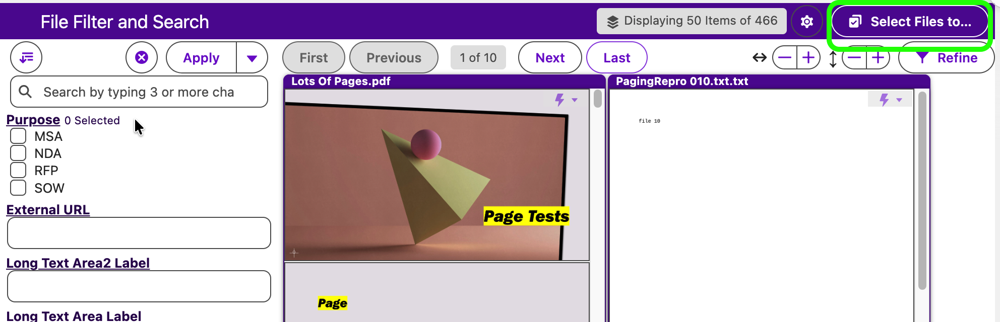
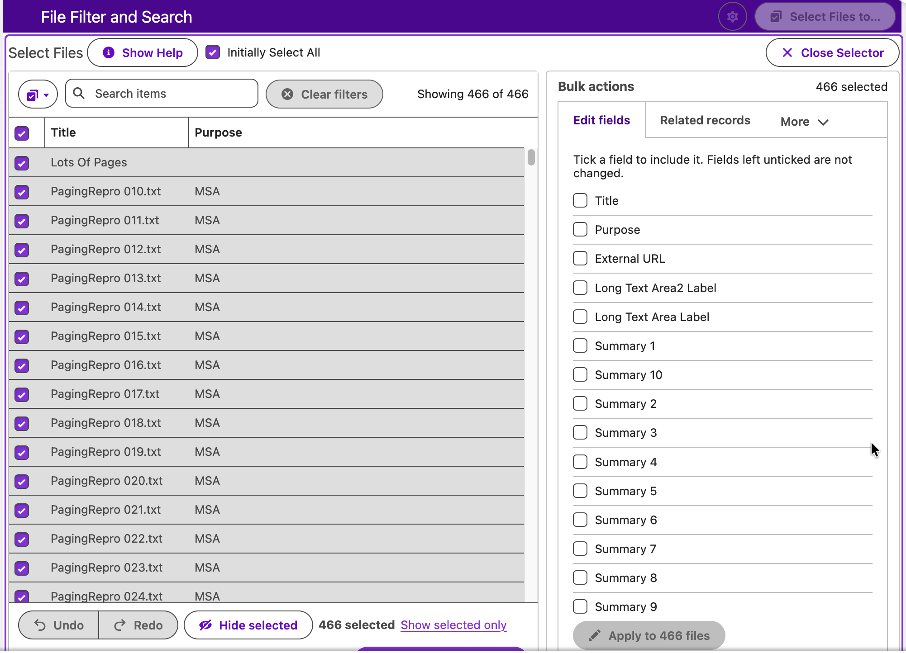
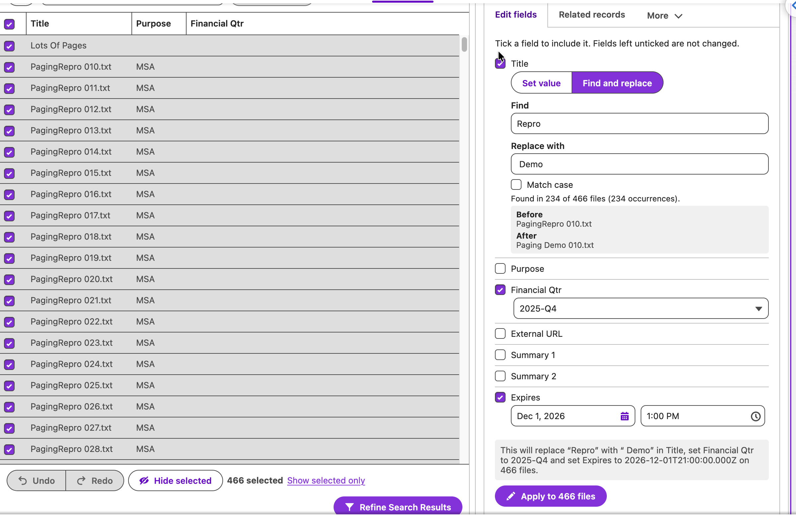
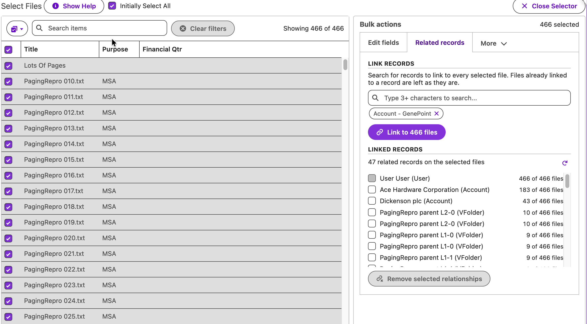
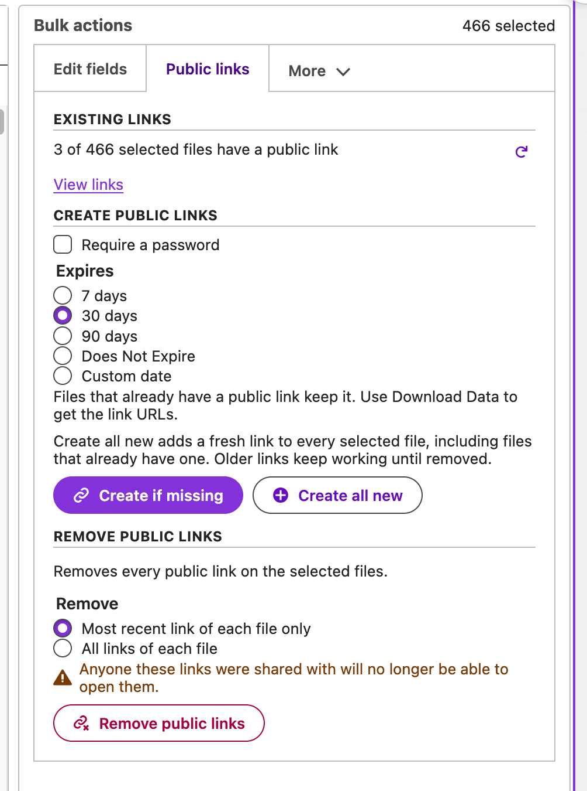
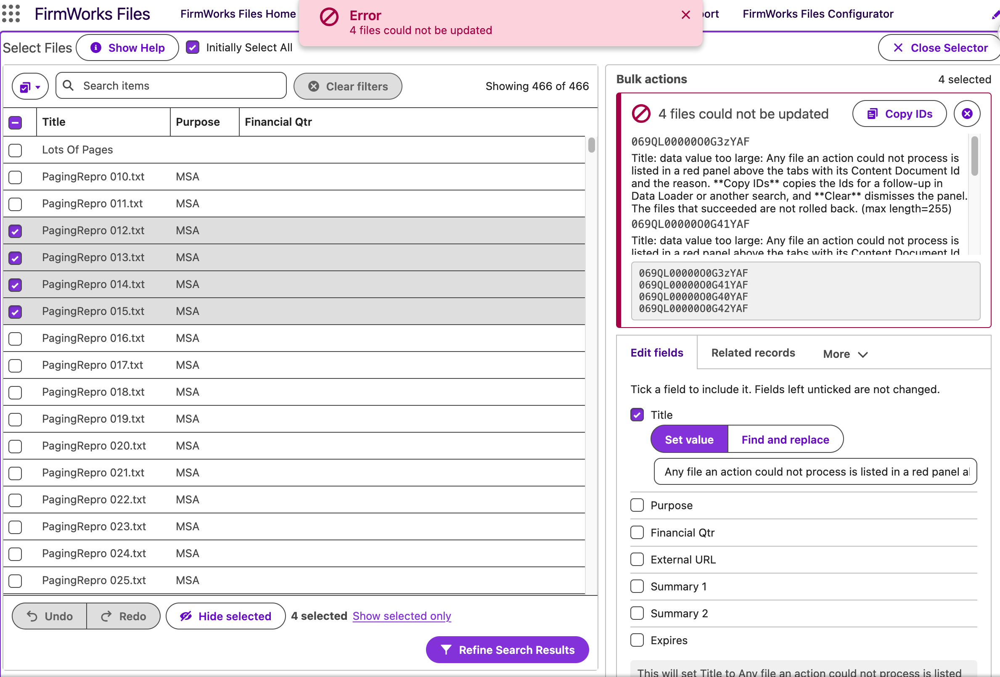

[Back To Documentation](index.md)

# Bulk Actions

Bulk actions let a user pick any number of files from a File Manager search and act on all of them at once. A **Select Files to…** button opens a selector that holds every file the search returned, not just the current page. Next to it, a **Bulk actions** pane offers the actions the administrator has enabled.

This page is the end-user guide. Administrators enable each action in a configuration; see [Enabling bulk actions](#enabling-bulk-actions).

- [Bulk Actions](#bulk-actions)
  - [Opening the selector](#opening-the-selector)
  - [Selecting files](#selecting-files)
  - [Edit fields](#edit-fields)
  - [Related records](#related-records)
  - [Public links](#public-links)
  - [Download](#download)
  - [Delete](#delete)
  - [When something fails](#when-something-fails)
  - [Limits](#limits)
  - [Enabling bulk actions](#enabling-bulk-actions)

## Opening the selector

Run a search in [File Manager](component-appendix.md), then click **Select Files to…** in the header. The button is hidden when no bulk action is enabled for the configuration, and disabled while the search has no results or the selector is already open.

File Manager loads the whole result set into the selector. A **Loading items…** message shows while that happens. Large text fields arrive as previews of their first 255 characters to keep the load fast; see [Edit fields](#edit-fields) for when that matters.

Above the selector:

- **Show Help** opens a panel describing the mouse, keyboard and touch gestures.
- **Initially Select All** selects every file as soon as the selector loads. It is on by default and remembered per browser.
- **Close Selector** returns to the normal results. If you edited fields or deleted files, the search re-runs so the results are current.

The **Refine** button on the results toolbar opens the same selector without the actions pane. Use it to narrow a search by hand: select the files you want, click **Refine Results**, and File Manager shows only those files until you clear the search.

## Selecting files

The selector is a grid with one row per file and the same columns as the list view. The toolbar and footer control selection.

When the configuration's **Check Record Access** setting is on, files you cannot edit show a lock icon beside their checkbox with the tooltip "You can view this file but can't edit its details." They can still be selected; the actions that need edit, delete or owner access skip them and say so on the tab before you run. See [Read-only files](component-appendix.md#read-only-files).

**Toolbar**

- The **Selection options** menu offers **Select all filtered**, **Clear filtered**, **Invert filtered** and **Clear all**. "Filtered" means the rows currently matching the search box and column filters.
- **Search items** matches words anywhere in the visible columns. Matches are highlighted.
- Number, date, time and checkbox columns have a filter icon. Choose **Between**, **Equals**, **Not equal**, **At least** or **At most** (checkboxes offer **Any**, **True**, **False**), tick **Include blank values** if needed, and click **Apply**.
- **Clear filters** removes every column filter and the search text. The count of active filters shows on the button.
- **Showing N of M** on the right reports how many rows match.

**Grid**

- Click a row or its checkbox to select or clear it. Shift-click another row to select everything in between.
- Drag across rows to paint a selection. Start on an unselected row to select, on a selected row to clear.
- The header checkbox selects or clears everything matching the current filters. Clicking the header cell beside it sorts selected rows first, then unselected first, then off.
- Drag a column edge to resize it. Double-click the edge to reset.

**Footer**

- **Undo** and **Redo** step through selection changes, up to 50 steps. Hovering the button names the step it will reverse.
- **Hide selected** takes the selected rows out of view. They are not changed anywhere else and they are no longer selected. **Show hidden** brings them back.
- **N selected** shows the selection size. When filters hide some selected rows, the footer adds **N hidden by filter**.
- **Show selected only** limits the grid to the selection. **Show all** returns to everything and clears the filters.

**Keyboard**

| Key | Action |
|---|---|
| Up / Down | Move the highlight. Home / End jump to the first or last row. |
| Space | Select or clear the highlighted row. |
| Shift + Up / Down | Extend the selection. |
| Ctrl or Cmd + A | Select everything matching the filters. |
| Ctrl or Cmd + Z | Undo the last selection step. Ctrl or Cmd + Shift + Z, or Ctrl + Y, redoes it. |
| Escape | Close an open filter editor without applying it. |

On touch screens, tap a row to select or clear it, and press and hold a row until it highlights, then drag to paint a selection.

Your selection is kept while you filter, sort and page. There is no limit on how many files you can select.

## Edit fields

Sets tag values on every selected file. Requires **Allow Bulk Edit** in the configuration and edit access to the fields. Read-only files in the selection are counted above the fields, "3 of 20 selected files are read only and will be skipped.", and left unchanged.

1. Tick each field you want to change. Fields left unticked are not touched.
2. Enter the value. The options depend on the field type:
   - **Multi-select picklists** have a **Mode** of **Replace**, **Add** or **Remove**.
   - **Text fields** have a **Mode** of **Set value** or **Find and replace**. Find and replace takes **Find**, **Replace with** and **Match case**, and reports live how many files and occurrences match, with a **Before** and **After** sample.
   - **Picklists** list only the values that every selected file's record type allows. If the record types share no values, the field says so.
   - Leaving a ticked field empty clears it on every selected file. Fields that cannot be empty, such as Title, show "is required and cannot be cleared".
3. Read the preview sentence, for example "This will set Status to Approved and clear Reviewed By on 140 files."
4. Click **Apply to N files** and confirm.

Files are updated in groups of 200 with a progress bar. When it finishes you see how many files were updated and how many already had those values.

**Revert last edit** restores the previous values on the files that were changed, regardless of what is selected now. It is available once, for the most recent edit.

**Large text fields.** Fields such as Description load as 255-character previews. You can **Set value** on a preview, but **Find and replace** needs the full text so it does not miss matches. Click **Load full text** on the field, or **Load full row details** on the selector toolbar, to fetch the complete values. Loading full rows is limited to 200 files at a time; narrow the selection if asked.

Fields that a record's display rules hide on a particular file are skipped and listed in the result panel.

## Related records

Links or unlinks records on every selected file, or changes the files' owner. The tab appears when **Allow Bulk Related Records** or **Allow Bulk Owner Change** is on. Read-only files in the selection are counted on the tab: files you cannot edit "will not be linked", and files you cannot transfer "will keep their owner".

**Link records.** Search for one or more records and click **Link to N files**. Every selected file is linked to each record with the share type and visibility from the configuration. Files already linked to a record are left as they are, and the result reports how many links were created and how many already existed.

**Linked records.** The table lists every record currently linked to any selected file and on how many of them. Tick records and click **Link selected relationships** to link them to every selected file that does not have them yet, or **Remove selected relationships** to unlink them from every selected file. Linking is additive, like Link records: files already linked are left as they are, and the result reports how many links were created. A file's owner link can never be removed; those rows are disabled with a note.

**Change owner.** When your search picks exactly one user, a **Change owner to Name** button appears. Confirm to make that user the owner of every selected file. Files they already own are skipped. Requires **Allow Bulk Owner Change** and the right to transfer the files.

## Public links

Creates, reviews and removes public links on the selected files. The tab appears when the org has Content Deliveries enabled and the configuration shows **Public Link Creation** or **Public Link Delete**.

**Existing links.** The summary reads "N of M selected files have a public link". **View links** opens a table with the file, the view link, the download link, the password and the expiry, with expired links marked. From here:

- **Copy for email** copies the links as formatted HTML to paste into an email.
- **Copy as text** copies a plain-text list.
- **Show HTML** reveals the markup to select and copy by hand, for mail clients that do not accept rich paste.

**Create public links.** Tick **Require a password** to have Salesforce generate one per link. Choose an expiry of **7 days**, **30 days**, **90 days**, **Does Not Expire** or **Custom date** (at least one day from now). Then:

- **Create if missing** adds a link only to files that have none. Files with a link keep it.
- **Create all new** adds a fresh link to every selected file, including files that already have one. Older links keep working until removed.

Use **Download Data** to export the link URLs and passwords.

**Remove public links.** Choose **Most recent link of each file only** or **All links of each file**, then click **Remove public links** and confirm. Anyone those links were shared with will no longer be able to open them.

## Download

Two groups, enabled separately.

**Download Files** (requires **Show Download Files**) downloads the selected files as a zip. Salesforce builds zips of up to 800 files, so a larger selection is split into several downloads, each opening in its own tab. A dialog lists every link so you can retry one a pop-up blocker stopped.

**Data export** (requires **Show Download Data**):

- **Download Data** produces `ExportData.csv` with every configured field and public link for the selected files. Large text fields are exported in full.
- **Download Relationships** produces `ExportContentDocumentLinks.csv` listing the records each file is linked to.

## Delete

Deletes the selected files. Requires **Allow Bulk Delete** and delete access to the files. Files you cannot delete are counted on the tab and skipped.

Click **Delete Files** and confirm. Files are deleted in groups of 200 with a progress bar. Deleted files go to the Salesforce recycle bin, where an administrator can restore them; they cannot be restored from File Manager. Deleted files disappear from the selector and the results.

## When something fails

Any file an action could not process is listed in a red panel above the tabs with its Content Document Id and the reason. **Copy IDs** copies the Ids for a follow-up in Data Loader or another search, and **Clear** dismisses the panel. The files that succeeded are not rolled back.

## Limits

| What | Limit |
|---|---|
| Files per selection | No limit. The whole search result is loaded. |
| Files per server call | 200 for edit, related records, public links and delete. Progress shows each group. |
| Files per zip download | 800. Larger selections produce several zips. |
| Load full row details | 200 files per request. |
| Large text preview | First 255 characters until full text is loaded. |
| Undo and redo | 50 steps. |

Every action runs with the user's own permissions and sharing. A file the user cannot edit, delete or share fails for that file only and is reported in the result panel.

## Enabling bulk actions

Administrators turn bulk actions on per [FirmWorks Files Configuration](configuration.md#step-11-actions), in **Step 11: Actions**. The **Select Files to…** button appears as soon as any of these is on. The four Bulk Actions settings are off by default.

| Setting | Enables |
|---|---|
| Allow Bulk Edit Fields Action | The Edit fields tab and Revert. Users still need edit access to the fields. |
| Allow Bulk Delete Action | The Delete tab. Users still need delete access to the files. |
| Allow Bulk Related Records Action | Link records, Link selected relationships and Remove selected relationships on the Related records tab. |
| Allow Bulk Owner Change Action | Change owner on the Related records tab. |
| Show Download File Action | Download Files. On by default. |
| Show Download Data/Relationships Action | Download Data and Download Relationships. On by default. |
| Show Create Public Links Action | Create public links. |
| Show Delete Public Links Action | Remove public links. |

There is no separate permission for bulk actions. A user who can use File Manager with a configuration that enables an action can run it on the files they have access to.
