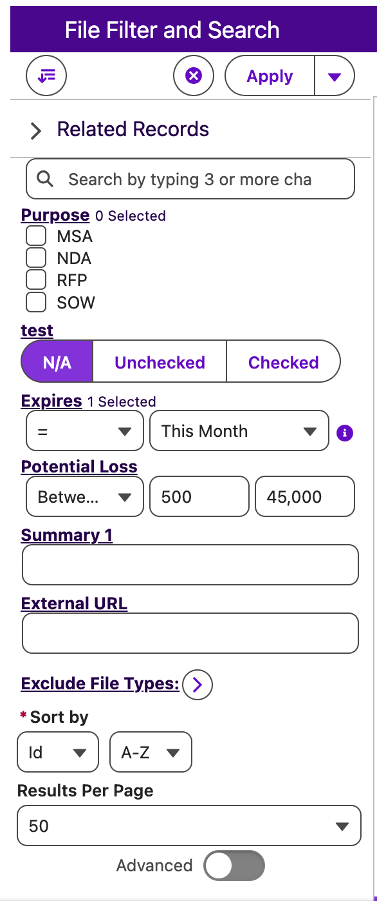
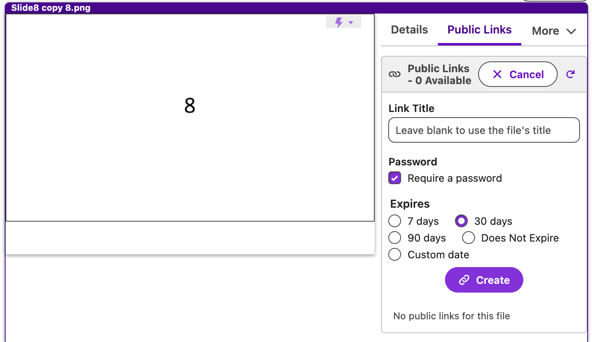
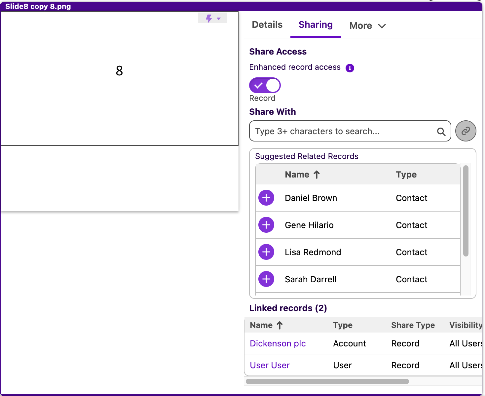
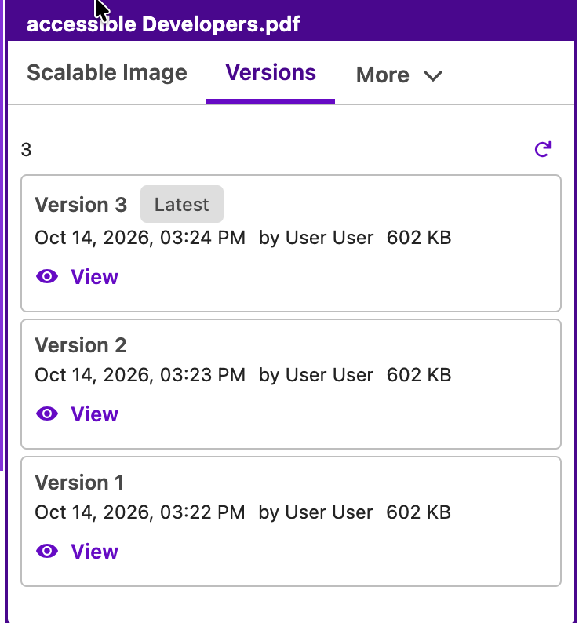
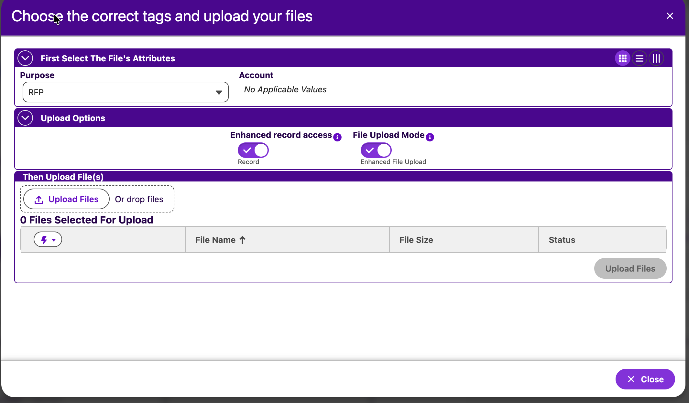
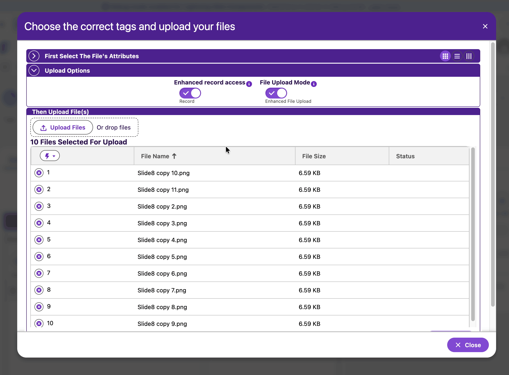

[Back To Documentation](index.md)

# Using File Manager

File Manager is the component behind the **File Search** tab and the FirmWorks File Manager component on record pages. Before 2.1 it was called FileViewer. This page walks through what users see. Administrator settings are in the [Component Reference](component-reference.md#firmworks-file-manager) and [Configuration](configuration.md).

- [Using File Manager](#using-file-manager)
  - [The header](#the-header)
  - [Settings](#settings)
    - [Appearance](#appearance)
    - [Detail Tabs](#detail-tabs)
    - [Fields](#fields)
  - [Search panel](#search-panel)
  - [Results](#results)
  - [Tile view](#tile-view)
  - [List view](#list-view)
  - [File details](#file-details)
  - [Versions](#versions)
  - [Previewing files](#previewing-files)
  - [Downloading files](#downloading-files)
  - [Bulk actions](#bulk-actions)
  - [Sharing a search](#sharing-a-search)
  - [URL parameters](#url-parameters)
  - [Mobile](#mobile)
  - [Uploading with File Tagger Button](#uploading-with-file-tagger-button)

## The header

From left to right: the component title, a badge with the number of results, the **Settings** gear, and **Select Files to…** when the administrator has enabled any [bulk action](bulk-actions.md). Two icons appear only when you have customised the view: one resets the displayed fields to the administrator's defaults, the other resets the search fields.

## Settings

The gear icon opens the settings panel. Choices are remembered per user, and per component when the administrator has set a Cache Id. **Clear Cache** forgets everything you have set here.

### Appearance

1. **Search Panel** shows or hides the search panel. The administrator can lock this.
1. **Results View** switches between **Tiles** and **List**.
1. **Show Titles** shows or hides file titles on tiles.
1. **Information Layout** places a tile's details **Vertical** (below the image) or **Horizontal** (to the right).
1. **Use Scalable Image** renders the document itself in tiles and in the list's preview pane instead of the Salesforce thumbnail.
1. **Width** and **Height** sliders size the scalable image and the list.
1. **Scroll List**: **Scroll** lets columns take the width of their content with a horizontal scroll bar. **Fit** squeezes them into the visible width.
1. **Large text fields**: **Previews** shows the first 255 characters of long text fields, **Full text** loads whole values in batches (slower), **Automatic** lets File Manager decide by row size.
1. **Remember Layout** saves the current tile size or preview pane size for your next visit.

### Detail Tabs

Each toggle shows or hides a tab on every file. A tab is only offered when the configuration allows it.

1. **Record Details**: the file's tags.
1. **Public Links**
1. **Sharing**: the records the file is linked to.
1. **Versions**: the file's version history. See [Versions](#versions).

### Fields

1. **Display Fields**: move fields between **Available** and **Displayed** to choose which tags appear on each file, then click **Apply**. This does not change which fields you can filter by. A note appears when some fields are set to display conditionally.
1. **Search Fields**: the same for the filters shown in the search panel.

## Search panel

The search panel sits on the left. Click **Apply** to run the search, or turn on **Auto Update On Criteria Changes** in the menu beside it to search as you change filters. **Clear** resets every filter.

1. **Find** searches file titles and text content. Type three or more characters. The administrator's Filter Objects setting decides which linked records can also be matched.
2. **Tag filters**: one control per filter field. Picklists and multi-select picklists show their values to tick. Checkboxes offer N/A, Unchecked and Checked. Lookup fields offer a record search. Text fields take a value.
3. **Numeric filters**: number, currency and percent fields take an operator (=, <, >, <=, >=, !=) and a value, or **Between** with a From and To.
4. **Date filters**: date and date/time fields take an operator and a value. The value can be **Any**, a **Specific date** (or date and time), or a relative period such as Today, Yesterday, This Week, Last Month, This Quarter, Last Year, Next N Days and the fiscal equivalents. Relative periods use the same Salesforce date literals as reports, so "Last Month" means the whole previous calendar month.
5. **Advanced**: a toggle that adds a **Criteria / Is Null / Not Null** choice to every filter. Is Null finds files where the field is empty; Not Null finds files where it has any value. **Search All Null Values** sets every filter to Is Null and searches, which finds untagged files. See [Historical File Clean-up](file-cleanup.md).
6. **Exclude File Types**: untick a type to include it. The administrator sets which types are excluded by default, usually Salesforce Notes.
7. **Related Records**: when the configuration has [Searching Related](configuration.md#step-9-searching-related) paths, a tree of related records appears. Expand a level, tick the records whose files you want included, and Apply. Some relationships may be selected for you automatically.
8. **Reports**: when the configuration enables the report runner, a **Select Report To Run** list lets you run a saved [File Report](file-reporting.md). The report's documents become the result set and you can filter them further.
9. **Sort by** and **Order** sort by any sortable field, ascending or descending.
10. **Results Per Page** sets how many files show per page. The administrator sets the default.
11. **Launch Last Search** appears after a search. See [Sharing a search](#sharing-a-search).

A warning icon reading "Admin Has A Configured Default Query Applied" means the administrator has applied a fixed filter you cannot remove.

## Results

Results page through with **First**, **Previous**, **Next** and **Last**. The **Refine** button opens the file selector so you can hand-pick files from the whole result set and show only those; see [Bulk actions](#bulk-actions).

When the view includes large text fields, a **Limited fields** notice explains that values are previews. **Load full text (slower)** fetches the complete values in batches, and **Show previews** returns to the fast mode. A single row can be loaded in full from its row menu.

## Tile view

Each file is a tile with a preview and its tag values.

1. **Preview**: the Salesforce thumbnail, or the document itself when Use Scalable Image is on. Click it to open the file in the viewer.
1. **Details**: click the pencil next to a tag to edit it. Files open in view, edit or read-only mode depending on the configuration.
1. **Public Links**, **Sharing** and **Versions** tabs, when enabled. See [File details](#file-details).
1. Notes show an **Open In NoteManager** button instead of a thumbnail.

The tile size buttons (plus and minus) and the Width slider in settings change how many tiles fit in a row.

## List view

List view shows one row per file with tag fields as columns, and a preview pane on the right.

1. Click the pencil in a cell to edit it. Each field validates according to its type. **Use Last Modified Values**, in the grid's menu, offers the value you last entered in a field as the default when you edit the next row. Useful for tagging many similar files.
1. Drag a column edge to resize it. Column widths are remembered for the session.
1. Click the eye icon on a row to open the file in the preview pane. A button collapses the pane to give the list more room.
1. Edits on earlier pages are kept while you move between pages.

## File details

Whether on a tile or in the list's preview pane, a file has up to five tabs:

1. **Scalable Image**: the file rendered at the size set by the sliders, with the file menu. See [Previewing files](#previewing-files).
1. **Details**: the file's tags, editable according to the configuration.
1. **Public Links**: create links, with or without passwords, set a title and an expiration, copy the view link, download link or password, see view counts, and delete links.

   

1. **Sharing**: link the file to any other record, change the share type, change the owner, or remove links. When the administrator has set up suggested relationships, related records such as an Opportunity's Account appear for one-click linking.

   

1. **Versions**: see below.

## Versions

The **Versions** tab lists every version of the file, newest first, with its number, a **Latest** badge on the current version, when and by whom it was uploaded, its size and the reason for change. The administrator enables the tab with **Show Versions Tab** in the configuration.

- **View** opens an older version in the viewer. **Close viewer** returns to the list.
- **Download** downloads that version.
- **Refresh versions** reloads the list.

**Prune version history** appears when the administrator has allowed it. It keeps only the latest version: the file is copied to a new file with the same related records, and the original file with all of its older versions is deleted. The confirmation spells out the consequences. Points to know before pruning:

- Public links of the original file stop working.
- The new file's owner is you if the original owner could not be kept.
- Only files stored in Salesforce can be pruned, not Files Connect references, and there is a size limit for files pruned this way.
- It cannot be undone.

## Read-only files

When the configuration's **Check Record Access** setting is on, File Manager works out as results load whether you can edit, delete or transfer each file, and shows it before you try:

- In the list view a lock icon in the row number column marks files you cannot edit, with the tooltip "You can view this file but can't edit its details." Their cells have no edit pencil and the row never enters edit mode. Saving a grid with read-only rows leaves those rows unchanged and says so.
- On tiles and in the details pane the Details form opens read only with the same notice beneath it.
- The file menu's Delete option is hidden on files you cannot delete, and the Versions tab shows "You can't delete this file." in place of Prune version history.
- On the Sharing tab, the Share with section and Change Owner are hidden when you cannot edit or transfer the file, and existing links cannot be removed.
- In bulk actions, read-only files can be selected but are skipped, with a count shown on the tab before you run. See [Bulk Actions](bulk-actions.md#selecting-files).

You can edit a file when you own it, have Modify All Data, hold a Collaborator share on it, can edit a record it is shared with through an inferred (Record) share, are a member of a Chatter group it is shared with, or can add content to a library it is in. A Viewer share does not allow editing. Deleting a file, pruning its versions and changing its owner require ownership or Modify All Data.

With the setting off, nothing is marked ahead of time and Salesforce reports the error when you save. Access is checked for up to 1,000 files per page. Beyond that, or when the files are linked to a very large number of records, the marks are left off and the save-time error applies.

## Previewing files

The viewer shows PDFs, Office documents and images from Salesforce's generated previews, plays video and audio, and renders text files, notes and Outlook message details. Salesforce generates previews in the background, so a file uploaded moments ago may show "No Preview Available"; **Retry Preview** checks again. Which types preview, and how, is listed in [Supported File Types](supported-file-types.md).

The **Show Menu** icon on a preview offers:

- **Refresh** reloads the preview.
- **Show In Browser's Viewer** streams the file to your browser and lets the browser render it. Use it for large PDFs, video, audio, HEIC photos and Files Connect files. Requires the **API Enabled** permission; users without it see an error naming the disabled API.
- **Navigate To Document** opens the file's own Salesforce page.
- **Download**, when the administrator shows it.
- **Delete**, when the administrator shows it.

## Downloading files

Downloading many files, whether from [bulk actions](bulk-actions.md#download), a File Report, or the Download Records Files component, requests files from Salesforce in batches of 800. Each batch downloads as its own zip in a new browser tab. When there is more than one batch, a dialog lists every download link so you can retry any that a pop-up blocker stopped.

On phones and tablets each download opens with a short delay and Salesforce may ask you to log in again in the browser.

## Bulk actions

**Select Files to…** loads every file from the current search into a selector where you can pick any number of them and then edit their tags, link or unlink records, change their owner, create or remove public links, download them or delete them. The same selector opens from **Refine** to narrow a search by hand. The full guide is [Bulk Actions](bulk-actions.md).

## Sharing a search

After applying a search, the **Launch Last Search** link (its help text reads "Launch query to share or bookmark in browser") produces a URL that reopens File Manager with the same search term, filters and sort. Bookmark it or send it to a colleague. The recipient still only sees files they have access to.

## URL parameters

The File Search tab (`/lightning/n/firmworks__File_Viewer`) accepts these parameters:

| Parameter | Purpose |
|---|---|
| `c__contentIds` | Comma delimited Content Document (069) or Content Version (068) Ids. Only these files are shown; searching and filtering work within them. Ids that are not 15 or 18 characters, or do not start with 068 or 069, are ignored. |
| `c__configurationName` | Developer name of the configuration to apply. |
| `c__search` | An encoded search produced by the Launch Last Search link, or by the Files Dashboard's untagged files tile. |
| `c__reportBuilder` | An encoded report, produced when File Report Results opens its files in File Manager. |

The Tag and Upload screens use `c__contentIds` for their "Open in File Manager" post-upload action. File Manager's **Open In NoteManager** button passes `c__noteId` to the Note Manager tab; see [Opening a note by URL](notes.md#opening-a-note-by-url).

A malformed parameter shows the message "Unable to parse the URL parameters correctly" and File Manager loads normally.

## Mobile

In the Salesforce mobile app File Manager uses an accordion layout with the search panel, results and preview in separate sections. In list view the preview sits above the list.

## Uploading with File Tagger Button

File Manager has no upload button of its own. Administrators pair it with **File Tagger Button**, **File Tagger** or the **Tag & Upload** quick action. Follow the steps in order so tags and sharing apply to every file.

1. **Tags**: set the tag values before choosing files. The values apply to every file uploaded in that batch. Change them and upload again to tag the next batch differently. Fields marked required must be filled first.
1. **Visibility**: whether the files are visible to All Users, including Experience Cloud users, or only to internal users (Default).
1. **Share type**: **Record** lets anyone with access to the record see and edit the files according to their record access. **Viewer** gives read-only access.
1. **Upload**: drag files one at a time, or click Upload Files to pick several. When [Enhanced Upload](enhanced-upload.md) is enabled you can switch to it here to upload hundreds of files with progress, duplicate detection and versioning.

After the upload, depending on the administrator's settings, the screen closes, shows the uploaded files as tiles, or opens them in the File Search tab.
