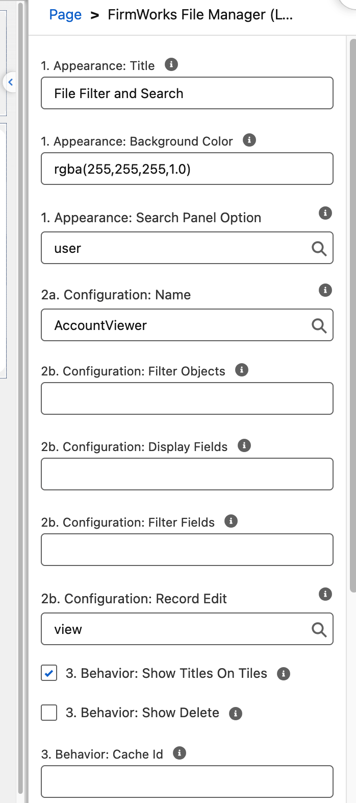
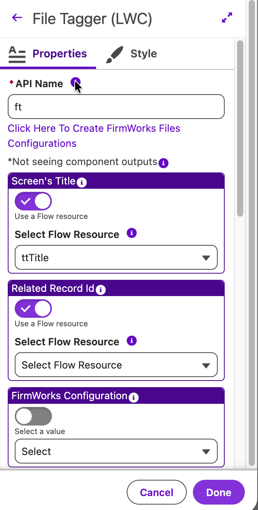
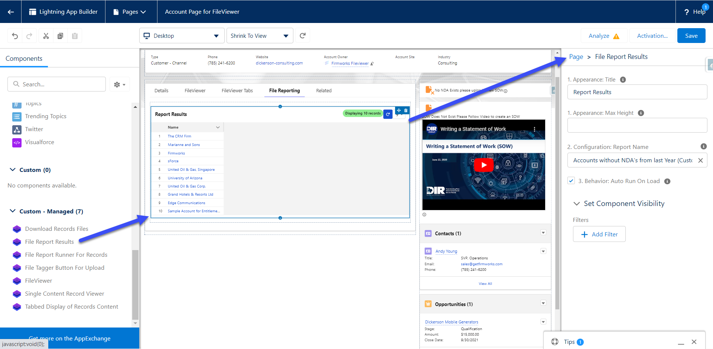

[Back To Documentation](index.md)

# Component Reference

Every Lightning component in the FirmWorks Files package, the places it can be added, and each setting it exposes. Settings are listed with the exact label shown in Lightning App Builder, Experience Builder or Flow Builder so you can match them on screen.

- [Where to find the components](#where-to-find-the-components)
- [Use a configuration first](#use-a-configuration-first)
- [Component summary](#component-summary)
- [FirmWorks File Manager](#firmworks-file-manager)
- [File Tagger](#file-tagger)
- [File Tagger Button](#file-tagger-button)
- [Record Reporter](#record-reporter)
- [Content Viewer](#content-viewer)
- [Single Content Record Viewer](#single-content-record-viewer)
- [FirmWorks Notes](#firmworks-notes)
- [File Report Results](#file-report-results)
- [Download Records Files](#download-records-files)
- [Tab-only components](#tab-only-components)
- [Flow property editors](#flow-property-editors)
- [Retired components](#retired-components)

## Where to find the components

In Lightning App Builder and Experience Builder the components appear in the **Custom - Managed** section of the component palette. In Flow Builder they appear under **Screen Components** when you add a screen. All of them are prefixed with the `firmworks` namespace in metadata.

Since 2.1 the components are Lightning Web Components and appear under their plain names. The original Aura components still appear in the palette so that existing pages keep working, but they are retired and their labels now start with **~DEPRECATED~**. Use the plain-named version for new placements and see [Upgrading to Lightning Web Components](component-tools.md) to move existing ones.

## Use a configuration first

Every component that works with tags has a **Configuration: Name** setting. Set it to a [FirmWorks Files Configuration](configuration.md) and leave the other settings at their defaults.

A configuration controls display fields, filter fields, required and read-only fields, conditional visibility, default values, default filters, sharing, related-record searching, upload behavior, view settings, bulk actions and which actions users see. The individual settings on a component cover only a fraction of that, and have to be repeated on every page. They remain for quick tests and for pages built before configurations existed.

Name a configuration after an object, for example `Account`, and it becomes the default for every component on that object's record pages and for the Tag & Upload quick action, so Configuration: Name can often stay blank. See [Default configurations by name](configuration.md#default-configurations-by-name).

## Component summary

| Component | Record page | App or Home page | Experience Cloud | Flow screen | Other |
|---|---|---|---|---|---|
| FirmWorks File Manager | Yes | Yes | Yes | Yes | Tab (File Search), record action, URL addressable |
| File Tagger | Yes | Yes | Yes | Yes | |
| File Tagger Button | Yes | Yes | Yes | Yes | |
| Record Reporter | Yes | Yes | Yes | Yes | |
| Content Viewer | Yes | Yes | Yes | Yes | |
| Single Content Record Viewer | Yes | Yes | No | No | |
| FirmWorks Notes | Yes | Yes | Yes | No | Tab (Note Manager), URL addressable, utility bar |
| File Report Results | Yes | Yes | Yes | Yes | Tab |
| Download Records Files | Yes | Yes | Yes | No | |
| FirmWorks Files Home | No | Yes | No | No | Tab |
| FirmWorks Files Dashboard | No | Yes | No | No | Tab |
| FirmWorks Files Component Tools | No | App page | No | No | Tab |

The packaged **Tag & Upload** quick action uses the retired File Tagger Aura component. It still works; see [Retired components](#retired-components).

## FirmWorks File Manager

The search, filter, view, tag, share and bulk-action component. Also the component behind the **File Search** tab. See [Using File Manager](component-appendix.md) for the end-user guide and [Bulk Actions](bulk-actions.md) for the Select Files to… feature.



> **Recommended:** set **2a. Configuration: Name** and leave the other settings at their defaults.

| Setting | Type | Default | Options | What it does |
|---|---|---|---|---|
| 1. Appearance: Title | Text | blank | | Title shown at the top of the component. |
| 1. Appearance: Background Color | Text | blank | | Background color as an rgba value, for example `rgba(255,255,255,1.0)`. |
| 1. Appearance: Search Panel Option | Picklist | user | hidden, off, on, user | `hidden` removes search entirely. `off` and `on` set the panel closed or open on load. `user` remembers each user's last choice. |
| 2. Configuration: Record Id | Text | blank | | Limits results to files related to this record. Not shown on record pages, where the record is taken from the page. In Experience Builder use `{!recordId}`. |
| 2a. Configuration: Name | Picklist | blank | Active configurations | **The FirmWorks Files Configuration to apply. Recommended.** |
| 2b. Configuration: Filter Objects | Text | blank | | Legacy alternative to 2a. Comma delimited object API names users can filter by. Use Step 6 of a configuration instead. |
| 2b. Configuration: Display Fields | Text | blank | | Legacy alternative to 2a. Comma delimited ContentVersion field API names to display. Use Step 3 of a configuration instead. |
| 2b. Configuration: Filter Fields | Text | blank | | Legacy alternative to 2a. Comma delimited ContentVersion field API names to filter by. Use Step 4 of a configuration instead. |
| 2b. Configuration: Record Edit | Picklist | view | view, edit, readonly | Whether file records open in view mode, edit mode, or as read-only. Also available as Default Record View State in a configuration's View Settings. |
| 3. Behavior: Show Titles On Tiles | Checkbox | checked | | Show or hide file titles in tile view. |
| 3. Behavior: Show Delete | Checkbox | unchecked | | Adds a delete option to the file menu. |
| 3. Behavior: Cache Id | Text | blank | | Up to six characters that keep this instance's user preferences separate from other File Manager instances. Leave blank to share preferences between instances. |
| 4. Data: Record Ids | Text | blank | | A list of record Ids whose files should be shown. |
| 5. Dynamic Configuration: Dynamic Filter Values | Text | blank | | JSON of field API names and values used to preset filter values. Numeric and date fields accept an operator object as well as a plain value. See [Dynamic Field Values](flow-dynamic-values.md#presetting-filters-in-file-manager). |

On a Flow screen the same settings are offered through a [property editor](#flow-property-editors). Reactive on a Flow screen: 1. Appearance: Title, 2. Configuration: Record Id, 2a. Configuration: Name, 4. Data: Record Ids and 5. Dynamic Configuration: Dynamic Filter Values. The other settings are read once when the screen loads. As a record action (Setup > Object Manager > Buttons, Links, and Actions > New Action > Lightning Web Component) it opens in a modal with no settings and shows the record's files.

## File Tagger

The Tag & Upload screen placed directly on a page or a Flow screen. Users choose the tag values a configuration asks for, then upload one or more files. Replaces the retired Aura File Tagger and File Upload & Tagger For Flows.

 

> **Recommended:** set **2a. Configuration: Name** and leave the other settings at their defaults. The configuration's Filter Fields, Default Values, Sharing and Upload Dialogs steps replace every setting in groups 2 and 2b below.

Settings on record, App, Home and Experience pages:

| Setting | Type | Default | Options | What it does |
|---|---|---|---|---|
| 1. Setup: Record Id | Text | blank | | The record the uploaded files are linked to. Not shown on record pages. In Experience Builder use `{!recordId}`. |
| 2a. Configuration: Name | Picklist | blank | Active configurations | **Configuration to apply. Recommended.** |
| 2b. Configuration: Content Version Fields | Text | blank | | Legacy alternative to 2a. Comma delimited ContentVersion field API names to show for tagging. |
| 2. Configuration: Allowed File Types | Text | blank | | Comma delimited file extensions, for example `.pdf,.docx,.png`. Blank allows all types. See [Restricting upload types](supported-file-types.md#restricting-upload-types). |
| 2. Configuration: Allow Multiple Documents | Checkbox | checked | | Allow more than one file per upload. |
| 2. Configuration: Allow Enhanced Uploads | Checkbox | unchecked | | Offer [Enhanced Upload](enhanced-upload.md). Requires the user to have API access. |
| 2. Configuration: Default Upload Mode | Picklist | LargeUpload | LargeUpload, EnhancedUpload | Which mode is selected when the screen opens. `LargeUpload` is the standard Salesforce upload. |
| 2b. Configuration: Show Sharing Options | Checkbox | checked | | Show the sharing section at all. |
| 2b. Configuration: Show Sharing Visibility | Checkbox | checked | | Show the visibility toggle (All Users or Internal Users). Requires Show Sharing Options. |
| 2b. Configuration: Show Sharing Type | Checkbox | checked | | Show the share type toggle (Record or Viewer). Requires Show Sharing Options. |
| 2b. Configuration: Sharing Type | Picklist | I | I, V | Default share type. `I` is Record (inferred from record access), `V` is Viewer. |
| 2b. Configuration: Sharing Visibility | Picklist | AllUsers | AllUsers, InternalUsers | Default visibility. |
| 3. Behavior: Show Post Upload Actions | Checkbox | unchecked | | Let the user choose what happens after upload. |
| 3. Behavior: Default Post Upload Action | Picklist | close | close, show_results, fileviewer | `close` clears the screen. `show_results` shows the uploaded files as tiles. `fileviewer` opens the File Search tab with the uploaded files. |

Settings on a Flow screen:

| Setting | Type | Default | Reactive | What it does |
|---|---|---|---|---|
| 1. Appearance: Screen's Title | Text | Upload | Yes | Title shown above the component. |
| 2. Setup: Related Record Id | Text | blank | Yes | Required. The record the uploaded files are linked to, usually the flow's `recordId`. |
| 3. Configuration: Name | Text | blank | Yes | **Configuration to apply. Recommended.** |
| 3. Configuration: Allowed File Types | Text | blank | Yes | Comma delimited file extensions. |
| 3. Configuration: Allow Multiple Documents | Checkbox | checked | | Allow more than one file per upload. |
| 3. Configuration: Allow Enhanced Uploads | Checkbox | unchecked | | Offer Enhanced Upload. Requires API access. |
| 3. Configuration: Default Upload Mode | Text | LargeUpload | | `LargeUpload` or `EnhancedUpload`. |
| 3. Configuration: Dynamic Field Values | Text | blank | Yes | JSON of field API names and values to preset tags. See [Dynamic Field Values](flow-dynamic-values.md). |

Reactive settings update the component in place when the bound resource changes; see [Reactive settings](fileviewer-and-flow.md#reactive-settings). The others are read once when the screen loads.

Outputs available to later flow elements and to other components on the same screen:

| Output | Type | Contents |
|---|---|---|
| Output Content Document Ids | Text collection | ContentDocument Ids of the uploaded files. |
| Output Content Version Ids | Text collection | ContentVersion Ids of the uploaded files. |
| Output Content Document Link Ids | Text collection | ContentDocumentLink Ids created for the related record. |

All three outputs are reactive, so a component on the same screen bound to one of them, such as Content Viewer, updates as files are uploaded.

See [FirmWorks Files and Flows](fileviewer-and-flow.md) for a walkthrough.

## File Tagger Button

A button that opens File Tagger in a modal. Compact, and the usual choice for record pages. Replaces File Tagger Button For Upload.

<!-- SCREENSHOT NEEDED:  -->

> **Recommended:** set **3. Tagger: Configuration Name** and leave the other settings at their defaults. The configuration replaces every setting in groups 3 and 3a below.

Settings on record, App, Home and Experience pages:

| Setting | Type | Default | Options | What it does |
|---|---|---|---|---|
| 1. Setup: Record Id | Text | blank | | The record the uploaded files are linked to. Not shown on record pages. In Experience Builder use `{!recordId}`. |
| 2. Button: Label | Text | blank | | Button text. Blank uses the translated default, "Tag and Upload Files". |
| 2. Button: Appearance | Picklist | brand | base, neutral, brand, brand-outline, destructive, destructive-text, inverse, success | Salesforce Lightning Design System button variant. |
| 2. Button: Horizontal Location | Picklist | center | start, end, center, stretch | Horizontal position of the button. |
| 2. Button: Vertical Location | Picklist | center | start, end, center | Vertical position of the button. |
| 3. Tagger: Launched Screen's Title | Text | blank | | Title of the modal. Blank uses the translated default. |
| 3. Tagger: Configuration Name | Picklist | blank | Active configurations | **Configuration to apply. Recommended.** |
| 3. Tagger: Content Version Fields | Text | blank | | Legacy alternative to Configuration Name. |
| 3. Tagger: Allowed File Types | Text | blank | | Comma delimited file extensions. Blank allows all types. |
| 3. Tagger: Allow Multiple Documents | Checkbox | checked | | Allow more than one file per upload. |
| 3. Tagger: Allow Enhanced Uploads | Checkbox | unchecked | | Offer Enhanced Upload. Requires API access. |
| 3. Tagger: Default Upload Mode | Picklist | LargeUpload | LargeUpload, EnhancedUpload | Mode selected when the modal opens. |
| 3a. Tagger Sharing: Show Sharing Options | Checkbox | checked | | Show the sharing section. |
| 3a. Tagger Sharing: Show Sharing Visibility | Checkbox | checked | | Show the visibility toggle. |
| 3a. Tagger Sharing: Show Sharing Type | Checkbox | checked | | Show the share type toggle. |
| 3a. Tagger Sharing: Sharing Type | Picklist | I | I, V | Default share type. |
| 3a. Tagger Sharing: Sharing Visibility | Picklist | AllUsers | AllUsers, InternalUsers | Default visibility. |
| 4. Behavior: Show Post Upload Actions | Checkbox | unchecked | | Let the user choose what happens after upload. |
| 4. Behavior: Default Post Upload Action | Picklist | close | close, show_results, fileviewer | Action after upload. |

On a Flow screen the property editor groups the same settings as **Button**, **Tagger** and **Sharing**, adds **2. Tagger: Related Record Id** (required) and **2. Tagger: Dynamic Field Values**, and provides the same three output collections as File Tagger. Every setting and output is [reactive](fileviewer-and-flow.md#reactive-settings).

## Record Reporter

Runs a saved [File Report](file-reporting.md) for one record and tells the user whether the record meets it, with links to the matching documents. On a Flow screen it can also block the Next or Finish button. Replaces File Report Runner For Records and File Report Runner For Flow Records.

<!-- SCREENSHOT NEEDED:  -->

| Setting | Type | Default | Options | What it does |
|---|---|---|---|---|
| 1. Appearance: Title | Text | blank | | Title shown at the top of the component. |
| 1. Appearance: Background Color | Text | blank | | Background color, any CSS color. |
| 2. Configuration: Record Id | Text | blank | | Shown in Experience Builder only; use `{!recordId}`. On record pages the record is taken from the page. |
| 3. Configuration: Report Name | Picklist | blank | Saved reports | Required. The report to evaluate. |
| 4. Behavior: Report Has Result Status | Picklist | success | success, warning, error, info | Icon style when the record is in the report results. |
| 4. Behavior: Report Without Result Status | Picklist | warning | success, warning, error, info | Icon style when the record is not in the results. |
| 4. Behavior: Report Has Result Message | Rich text | No missing documents | | Message when the record is in the results. Supports links, images and embedded video. |
| 4. Behavior: Report Without Result Message | Rich text | Missing documents | | Message when the record is not in the results. |
| 4. Behavior: Display Result Documents | Checkbox | checked | | Show links to the documents that satisfied the report. |
| 4. Behavior: No Action Message | Text | No Action | | Message when the record does not meet the report's object criteria at all. |

Flow screens add:

| Setting | Type | Default | Options | What it does |
|---|---|---|---|---|
| 2. Configuration: Related Record Id | Text | blank | | Required. The record to evaluate. |
| 3. Configuration: Hide Component | Checkbox | unchecked | | Hide the visual result and use the component only for validation. |
| 3. Control Flow: Successful Validation | Picklist | No_Validation | No_Validation, Report_With_Result, Report_With_No_Result | `No_Validation` never blocks. `Report_With_Result` blocks until the record is in the results. `Report_With_No_Result` blocks while it is. The matching message is shown as the validation error. |

Output: **Report Result**, true when the record met the report's criteria. Use it in a Decision element after the screen, or bind it to another component on the same screen.

Every Flow screen setting and the output is [reactive](fileviewer-and-flow.md#reactive-settings): the report runs again when the bound Related Record Id or Report Name changes, and the messages, statuses and Hide Component take effect as soon as their bound value changes. On a Flow screen **4. Behavior: Report Has Result Message** and **4. Behavior: Report Without Result Message** also accept a [text template](fileviewer-and-flow.md#text-templates), so the message and the validation error can include merge fields.

Rich text in the message fields:

```html
<a href="https://example.com/how-to-comply">How to bring this record into compliance</a>

<iframe width="560" height="315" src="https://www.youtube.com/embed/VIDEO_ID" title="Training video" frameborder="0" allowfullscreen></iframe>
```

## Content Viewer

Displays the files of a record, or of a list of records, as tabs, a carousel or tiles, with the viewer in place. Replaces Record's Content Viewer.

> **Recommended:** set **Configuration Name** and leave the other settings at their defaults. The configuration's [Default Filter](configuration.md#step-8-default-filter), [Searching Related](configuration.md#step-9-searching-related) and Image Settings decide which files appear and how.

| Setting | Type | Default | Options | What it does |
|---|---|---|---|---|
| Content Ids | Text | blank | | Comma delimited record Ids. Files linked to these records are shown. On a Flow screen this is **Collection of Ids**, a text collection. |
| Id of record to linked to content to display | Text | blank | | The record whose files to show. In Experience Builder use `{!recordId}`. |
| Configuration Name | Picklist | blank | Active configurations | **Configuration to apply. Recommended.** |
| View Style | Picklist | default | default, scoped, vertical, carousel, tile | `default` tabs load each file when clicked. `scoped` tabs load all files at once. `vertical` puts tabs on the left. `carousel` pages through files. `tile` shows a grid. |
| Behavior: Show Delete | Checkbox | unchecked | | Adds a Delete option to the file menu. |
| Appearance: Max Height | Number | blank | | Maximum height in pixels. |
| Appearance: Image Width | Picklist | 12 | 1 to 12 | Width of each item in twelfths of the component. 12 is full width, 6 is half, 3 is a quarter. |
| Behavior: Default Page Size | Picklist | 10 | 1, 5, 10, 20, 50, 100, All | Items per page in the tab and tile views. The pager appears once the list is longer than the page size or than ten items. |
| Appearance: Show Title Bar | Checkbox | unchecked | | Show a title bar over each item in the carousel and tile views, coloured from the org or site theme. |
| Behavior: Describing Field | Picklist | blank | Text and rich text fields on the file | A field on the file (ContentVersion) whose value is shown with each item and searched by the filter box, for example Description. Blank lets the configuration decide; if that is blank too, no text is shown. Title is not offered. |
| Appearance: Describing Field Position | Picklist | blank | Above the file (under the title), Below the file, Flip (rotate between file and text) | Where the describing text sits. Blank lets the configuration decide, else above. Three lines show at first, with **Show more**. Flip puts a rotate button in the title bar that swaps the file and the text. |

With a describing field set, the filter box reads **Filter by title or text** and matches the text as well as the title. Rich text fields render formatted; plain text fields turn URLs into links. In the tab views the text is shown without a title bar, since the tab already carries the file name. Values saved in the configuration's [Image Settings](configuration.md#image-settings-content-viewer-file-manager-upload-components) override the component's settings.

On a Flow screen every setting except Behavior: Default Page Size, Behavior: Describing Field and Appearance: Describing Field Position is [reactive](fileviewer-and-flow.md#reactive-settings). Bind **Collection of Ids** to File Tagger's Output Content Document Ids to preview files on the same screen as they are uploaded.

## Single Content Record Viewer

Displays one specific file by its ContentVersion Id.

| Setting | Type | Default | What it does |
|---|---|---|---|
| 1. Configuration: Content Version Id | Text | blank | The ContentVersion to display. |
| 2. Appearance: Max Height | Number | blank | Maximum height in pixels. Blank sizes the component to the file. |

To find a ContentVersion Id from a file, run this query in Developer Console or Workbench, replacing the ContentDocument Id:

```sql
SELECT Id FROM ContentVersion WHERE ContentDocumentId = '069...' AND IsLatest = true
```

## FirmWorks Notes

The FirmWorks Notes explorer and editor in one frame. Also the component behind the **Note Manager** tab. See [FirmWorks Notes](notes.md).

| Setting | Type | Default | Options | What it does |
|---|---|---|---|---|
| Record Id | Text | blank | | Experience Builder only; use `{!recordId}`. On record pages the record is taken from the page. |
| FirmWorks Notes Configuration Developer Name | Picklist | blank | Active configurations | Configuration whose Filter Fields become the note tags and search filters, and whose Suggested Field Relationships drive related-record suggestions. |
| Component Height (CSS value) | Text | blank | | Any CSS height, for example `700px`. Blank fills the window from where the component sits. The explorer and editor scroll inside this height. |

On a record page the component shows notes linked to that record and links new notes to it.

The component can also be a **utility item** (Setup > App Manager > edit the app > Utility Items > Add Utility Item > FirmWorks Notes), so notes open in a panel from the utility bar on every page of the app. As a utility item it offers FirmWorks Notes Configuration Developer Name and Component Height; left blank, the height fills the utility panel. A utility item has no record context, so it shows every note the user can see, and new notes are linked to records through the Related Records panel.

## File Report Results

Runs a saved [File Report](file-reporting.md) and shows the records and their documents in a sortable, pageable grid with CSV export, file downloads and a link into File Manager. The same grid shows the results inside the File Report builder. Replaces the retired Aura File Report Results.



| Setting | Type | Default | Options | What it does |
|---|---|---|---|---|
| 1. Appearance: Title | Text | blank | | Title shown above the grid. Blank shows "Report Results". |
| 1. Appearance: Background Color | Text | blank | | Background color of the grid, any CSS color. |
| 1. Appearance: Max Height | Number | blank | | Height of the grid in pixels. The grid scrolls inside it. Blank grows with the rows. |
| 1. Appearance: Rows Per Page | Number | 100 | | Rows rendered per page. Lower it for very wide reports. |
| 1. Appearance: Default Document Details View | Picklist | grouped | grouped, details | `grouped` shows one row per record with its documents summarised. `details` shows one row per record and document, with the document's fields as columns. Users can switch, and their last choice is remembered per report. |
| 2. Configuration: Report Name | Picklist | blank | Saved reports | Required. The report to run. |
| 3. Behavior: Auto Run On Load | Checkbox | unchecked | | Run the report when the page loads. Leave unchecked for large reports so users trigger it with **Refresh**. |
| 4. Data: Run for these Record Ids | Text | blank | | A comma, space or tab separated list of record Ids to evaluate instead of the whole report. |

The component does not read the page's record Id on its own. To scope it to the current record, pass `{!recordId}` in **4. Data: Run for these Record Ids**.

What users see:

- **Refresh** runs the report. **Stop Running** cancels a run and keeps the rows fetched so far. A badge shows progress, then "Displaying N Records".
- A **Grouped** / **Details** switch. Every column sorts. The **Name** column opens the record, and in the Details view **Title** opens the document.
- A pager with "Rows 1-100 of 2,340", a **Pages** / **Scroll** switch and **Results Per Page**, shown when there is more than one page or more than 25 rows.
- An actions menu: **Download Data**, **Download Current Page**, **Download Data With Note Contents** (Details view, when the results include notes), **Download Files** and **Show In FileViewer**. Downloads are described in [Results Buttons](file-reporting.md#results-buttons).
- If a run fails, the error shows above the grid with a **Copy error** button.

On a Flow screen, Title, Background Color, Max Height, Report Name and Run for these Record Ids are [reactive](fileviewer-and-flow.md#reactive-settings); Rows Per Page, Default Document Details View and Auto Run On Load are read once. Run for these Record Ids opens in the Use a Flow resource mode, and takes a [text template](fileviewer-and-flow.md#text-templates) that joins a collection with commas. The output **Report Result** is a number, the count of records the last run returned, for a Decision element after the screen or as a reactive input to another component on the same screen.

## Download Records Files

A single button, **Download Record's Files**, that downloads every file linked to a record as zip files. Files are requested in batches of 800; see [Downloading files](component-appendix.md#downloading-files) for what users see when a record has more files than that.

| Setting | Type | Default | What it does |
|---|---|---|---|
| Record Id | Text | {!recordId} | The record whose files to download. |

On record pages the component shows no settings. On App, Home and Experience pages set Record Id explicitly.

## Tab-only components

These components have no settings. They are the packaged tabs, and the LWC ones can also be placed on App Pages and Home Pages.

| Component label | Packaged tab | Purpose |
|---|---|---|
| FirmWorks Files Home | FirmWorks Files Home | The landing page: setup steps, dashboard shortcut, support and documentation links, shown according to the user's permissions. See [Quick Start](quick-start.md). |
| FirmWorks Files Dashboard | FirmWorks Files Dashboard | Org health view. See [Files Dashboard](files-dashboard.md). |
| FirmWorks Files Component Tools | FirmWorks Files Component Tools | Inventory and migration of retired Aura placements. See [Upgrading to Lightning Web Components](component-tools.md). |
| File Reporting | File Report | The [File Reporting](file-reporting.md) builder. Aura. |
| FirmWorks Files Configurator | FirmWorks Files Configurator | The [Configurator](configuration.md). Aura. |

## Flow property editors

File Manager, File Tagger, File Tagger Button, Record Reporter, Content Viewer and File Report Results each ship a custom property editor for Flow Builder. Settings are grouped the same way as in App Builder. Every row has a **Use a Flow resource** toggle: off, you type a literal value or pick from a list; on, you choose a resource of the same type. Configuration names and report names are offered as picklists. The editor validates required inputs before the screen can be saved.

The resource list for a setting holds, in this order:

- Flow variables, formulas and constants of the same type. Collection settings list only collections.
- Text templates, for any text setting. Merge fields are resolved when the screen runs. See [Text templates](fileviewer-and-flow.md#text-templates).
- Components on a screen whose value or output has the same type: standard inputs such as Text, Checkbox, Toggle, Lookup or Email, and the automatic outputs of other screen components, including the FirmWorks ones. Components on the screen being edited are labelled "this screen"; the rest carry their screen's label. A component whose outputs are stored in variables manually is not listed.

Settings whose help text starts with **\*REACTIVE\*** are reactive: bound to a component on the same screen, they update the component in place when that component's value changes. Settings without the marker are read once when the screen loads. Each component section above says which of its settings are reactive, and [Reactive settings](fileviewer-and-flow.md#reactive-settings) explains the behaviour with examples.

Flow Builder passes a screen's components to the property editor only after the screen has been saved. If a component you just added or renamed on the same screen is missing from the resource list, click **Done** on the screen, then open the screen editor again. The note **Not seeing component outputs** at the top of each editor is a reminder of this.

<!-- SCREENSHOT NEEDED:  -->

## Retired components

The Aura components below still ship so that existing pages, flows, quick actions and tabs keep working. In the palette their labels now start with **~DEPRECATED~**, and the first column shows the label as it appears there. They are no longer enhanced. New features such as bulk actions, the Versions tab, numeric and null filters and the Flow property editors exist only in the LWC versions.

| Retired component | Use instead | Setting changes |
|---|---|---|
| ~DEPRECATED~ FileViewer | FirmWorks File Manager | Identical settings. The deprecated `searchObjects` setting is dropped. |
| ~DEPRECATED~ File Tagger | File Tagger | Identical settings. Default Upload Mode `BatchUpload` is now `EnhancedUpload`. |
| ~DEPRECATED~ File Upload & Tagger For Flows | File Tagger | Identical inputs and outputs. |
| ~DEPRECATED~ File Tagger Button For Upload | File Tagger Button | Identical settings. |
| ~DEPRECATED~ File Report Runner For Records | Record Reporter | Identical settings. |
| ~DEPRECATED~ File Report Runner For Flow Records | Record Reporter | Identical settings; the output is named Report Result. |
| ~DEPRECATED~ File Report Results | File Report Results | Identical settings; adds 1. Appearance: Background Color and 1. Appearance: Rows Per Page. On a Flow screen the output Report Result is the number of records returned. |
| ~DEPRECATED~ Record's Content Viewer | Content Viewer | 1. Configuration: Record Id is now Id of record to linked to content to display; 2. Appearance: View Style is now View Style. |
| ~DEPRECATED~ Single Content Record Viewer | Single Content Record Viewer | Identical settings. |
| ~DEPRECATED~ FirmWorks Notes | FirmWorks Notes | Identical configuration setting; adds Component Height. |
| ~DEPRECATED~ FirmWorks Files Landing Page | FirmWorks Files Home | No settings. |

The **FirmWorks Files Component Tools** tab lists every place a retired component is still used and can replace most of them in place. Quick actions and custom tabs cannot be changed by the tool; the packaged **Tag & Upload** quick action in particular continues to use the retired File Tagger. See [Upgrading to Lightning Web Components](component-tools.md).
