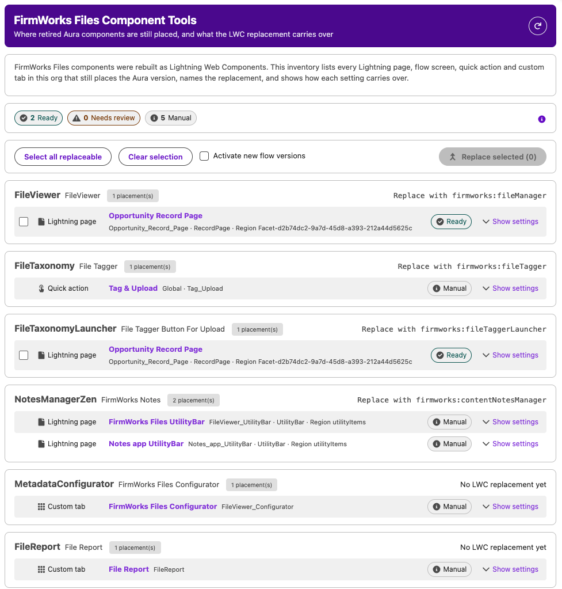
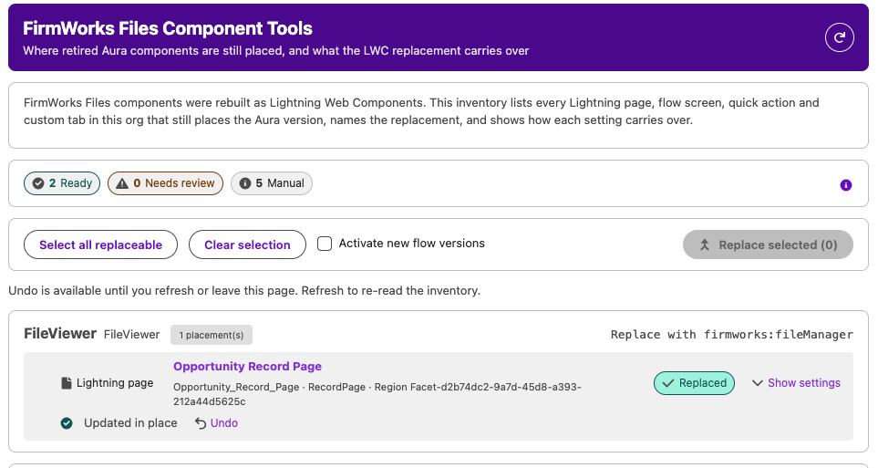

[Back To Documentation](index.md)

# Upgrading to Lightning Web Components

In 2.1 every FirmWorks Files component you place on a page was rebuilt as a Lightning Web Component. The original Aura components are **retired**: they still work after you upgrade, but they no longer receive new features, and the packaged tabs already use the LWC versions. We recommend moving every placement to the LWC version, and the **FirmWorks Files Component Tools** tab does most of that for you.

- [Upgrading to Lightning Web Components](#upgrading-to-lightning-web-components)
  - [What changed](#what-changed)
  - [Component map](#component-map)
  - [Component Tools](#component-tools)
    - [The inventory](#the-inventory)
    - [Replacing placements](#replacing-placements)
  - [What Component Tools cannot change](#what-component-tools-cannot-change)
  - [Prerequisites](#prerequisites)

## What changed

- The **File Search**, **Note Manager** and **FirmWorks Files Home** tabs now run the LWC components. Nothing is needed from you for those.
- New features such as [bulk actions](bulk-actions.md), the Versions tab, numeric and null filters, and the Flow property editors are built into the LWCs.
- Each retired Aura component now appears in Lightning App Builder, Experience Builder and Flow Builder with **~DEPRECATED~** in front of its label, so you can tell the two apart in the palette. The LWC carries the plain name, and every component has a new palette icon.
- Components on Flow screens now have a custom property editor. Each setting can take a literal value or a Flow resource through a **Use a Flow resource** toggle, and most settings are [reactive](fileviewer-and-flow.md#reactive-settings) to components on the same screen.
- A configuration set on an Aura placement works unchanged on the LWC placement.

## Component map

| Retired Aura component (palette label) | Replacement | Notes |
|---|---|---|
| ~DEPRECATED~ FileViewer | FirmWorks File Manager | Also available as a record action and a Lightning Component Tab. The deprecated `searchObjects` setting is dropped. |
| ~DEPRECATED~ File Tagger | File Tagger | One component now serves pages and Flow screens. |
| ~DEPRECATED~ File Upload & Tagger For Flows | File Tagger | Same outputs: Content Document Ids, Content Version Ids, Content Document Link Ids. A Default Upload Mode of `BatchUpload` becomes `EnhancedUpload`. |
| ~DEPRECATED~ File Tagger Button For Upload | File Tagger Button | Now also usable on Flow screens. |
| ~DEPRECATED~ File Report Runner For Records | Record Reporter | |
| ~DEPRECATED~ File Report Runner For Flow Records | Record Reporter | One component; the Flow output is named `result`. |
| ~DEPRECATED~ Record's Content Viewer | Content Viewer | Adds Default Page Size and Show Title Bar. |
| ~DEPRECATED~ Single Content Record Viewer | Single Content Record Viewer | Settings: Content Version Id, Max Height. |
| ~DEPRECATED~ FirmWorks Notes | FirmWorks Notes | The setting FirmWorks Notes Configuration Developer Name is now Configuration: Name. |
| ~DEPRECATED~ FirmWorks Files Landing Page | FirmWorks Files Home | |
| ~DEPRECATED~ File Report Results | File Report Results | Identical settings. Adds Background Color and Rows Per Page; on a Flow screen the output Report Result is the number of records returned. |
| File Report, FirmWorks Files Configurator | No replacement yet | These stay on Aura in 2.1 and are not retired. Leave them in place. |

Settings are documented per component in the [Component Reference](component-reference.md).

## Component Tools

Open the **FirmWorks Files Component Tools** tab from the App Launcher, or from the **Migrate Aura Component Tools** tile on the [Files Dashboard](files-dashboard.md). It is not in the FirmWorks Files app's navigation by default.

On load, the tool reads every Lightning page, flow screen, quick action and custom tab in the org that still places a retired Aura component. It reads through the Tooling API, which takes a moment: "Reading Lightning pages, flows, quick actions and tabs..." shows while it runs. If nothing is left, it says "No retired Aura components are placed in this org."

### The inventory

Placements are grouped by Aura component and summarised as:

- **Ready**: every setting copies to the LWC as is.
- **Needs review**: a value that was typed on the Aura placement has no place on the LWC and would be lost. Open the placement and decide whether that matters.
- **Manual**: the placement cannot be swapped by API, or no LWC replaces it yet. The row explains what to do instead.

Each placement shows its kind (Lightning page, Flow screen, Quick action, Custom tab), its name, the region or screen it sits in, the flow version, and an **Open in builder** link. **Show settings** lists every Aura setting with its value and how it carries over:

| Carries over as | Meaning |
|---|---|
| Copies | Same setting, same value. |
| Renamed | Same meaning under a different setting name on the LWC. |
| Translated | Same setting, the value is spelled differently on the LWC, for example `BatchUpload` becomes `EnhancedUpload`. |
| Supplied by the page | The page provides it, such as the record Id on a record page. The typed value is dropped. |
| Deprecated, dropped | The Aura setting has no equivalent. |
| Not on the LWC, dropped | The LWC does not have this setting for this page type. |

Flow placements also list their **Flow outputs**, which keep their names.

### Replacing placements

1. Tick the placements to change, or click **Select all replaceable**. Manual rows cannot be selected.
2. Optionally tick **Activate new flow versions**. Flows are never edited in place; a replaced flow gets a new draft version, and this option activates it.
3. Click **Replace selected (N)** and confirm. In a production org the confirmation adds a recommendation to make the change in a sandbox and deploy it.

Lightning pages are updated in place and report "Updated in place". Flows report "New draft version N created" or "New version N created and activated". A failure shows the reason on the row.

Every change has an **Undo** button on its row until you refresh or leave the page. Undo restores the Aura placement on a page, or removes the new flow version. After leaving, use Setup to revert if needed.

Quick actions, custom tabs and anything shipped by a managed package are inventoried but never written to.

## What Component Tools cannot change

| Placement | Why | What to do |
|---|---|---|
| Custom tab on an Aura component | Salesforce does not allow a tab's component to change. | Create a new Lightning Component tab on the LWC, add it to your apps, then delete the old tab. See [Creating a new tab](advanced-config.md#creating-a-new-tab). |
| Quick action on an Aura component, including the packaged **Tag & Upload** action | A quick action's type cannot change. | Create a new quick action on the LWC, place it where the old one sits in page layouts, then delete the old action. |
| Placements shipped by a managed package | A package upgrade updates them. | Nothing. |
| File Report, FirmWorks Files Configurator | No LWC replacement yet. | Leave them in place. |
| A page type the LWC does not support | For example Single Content Record Viewer is not available in Experience Cloud. | Leave the placement, or rebuild it on a supported page type. |

The tool reads at most 150 records of each kind. If an org has more, it says so and you can run it again after replacing the first batch. If Salesforce's Dependency API is unavailable, Lightning pages are scanned one by one and flows and quick actions are not checked.

## Prerequisites

Component Tools reads and updates metadata through the Tooling API, so the user needs all of:

- The **FirmWorks Files Component Tools** permission set. It grants the custom permission of the same name, the Component Tools and Dashboard tabs, and the supporting pages. It is not part of any permission set group; assign it directly. A permission set assigned during the current session takes effect at the next login.
- **View Setup and Configuration**.
- **Customize Application**.
- **API Enabled**.

The tab lists whichever of these is missing under "Access required" instead of loading. See [Permissions and Licensing](permissions.md).
