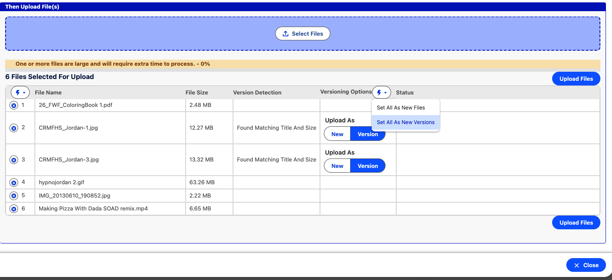
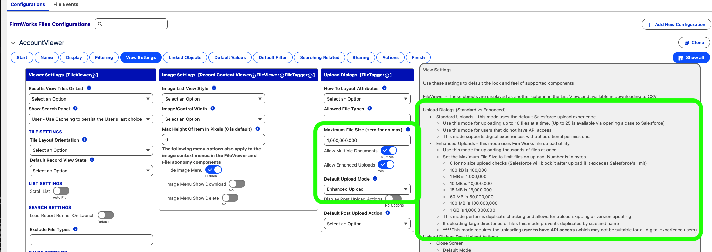
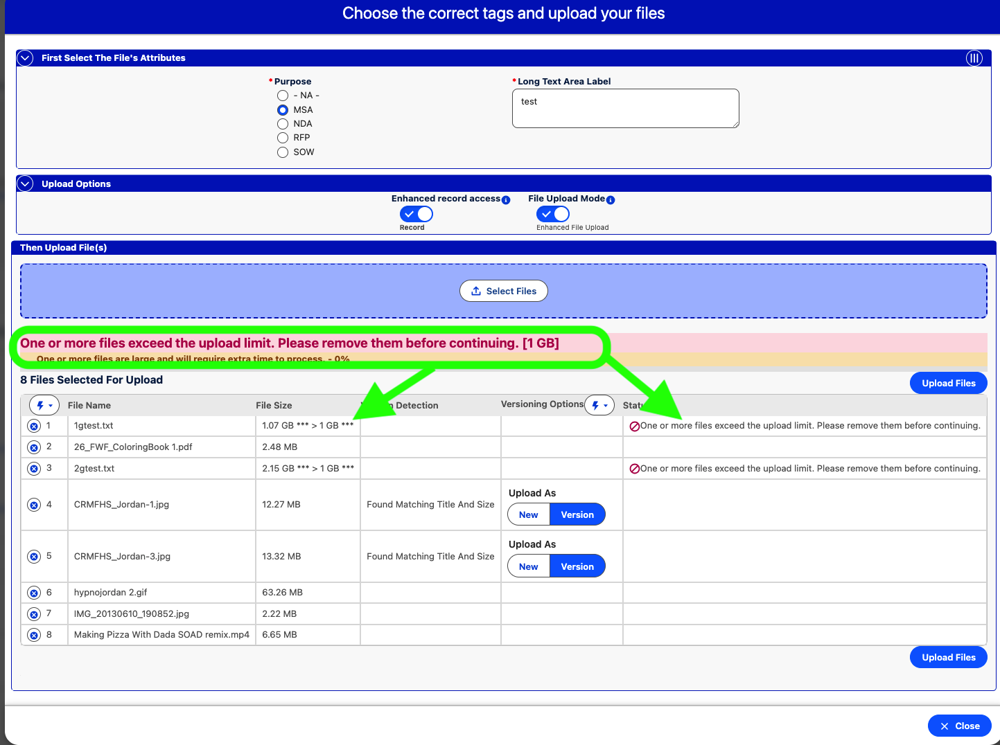
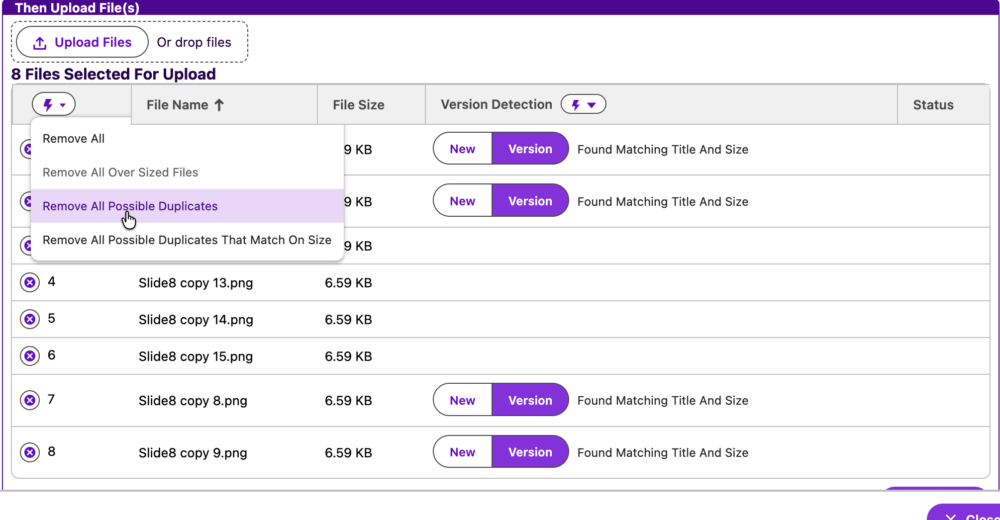

[Back To Documentation](index.md)

# Enhanced Upload

Formerly Bulk Upload. Enhanced Upload replaces Salesforce's standard upload, which takes 10 files at a time (25 by request to Salesforce), with a mode that takes thousands of files in one session, detects duplicates, supports versioning, and enforces a maximum file size before the upload starts.

- [Requirements](#requirements)
- [Enabling Enhanced Upload](#enabling-enhanced-upload)
- [Uploading](#uploading)
- [Duplicate detection and versioning](#duplicate-detection-and-versioning)
- [Maximum file size](#maximum-file-size)
- [Removing files from the list](#removing-files-from-the-list)
- [Cancelling an upload](#cancelling-an-upload)
- [Identifying files uploaded this way](#identifying-files-uploaded-this-way)
- [Troubleshooting](#troubleshooting)

## Requirements

- The uploading user needs the **API Enabled** permission. Enhanced Upload calls Salesforce APIs directly from the browser: files under 35 MB go through the SOAP API and files of 35 MB or more through the REST API. Users without API access should use standard upload.
- If clickjack protection is enabled for Visualforce pages, the Lightning domain must be a trusted domain. See [Troubleshooting](#troubleshooting).
- Experience Cloud users need the Experience User permission set, which includes the supporting classes and the FirmWorks Files Batch File Support page.

## Enabling Enhanced Upload

Enhanced Upload is off by default. Turn it on in one of two places:

- In a [FirmWorks Files Configuration](configuration.md#step-5-view-settings), under View Settings > Upload Dialogs: **Allow Enhanced Uploads**. Optionally set **Default Upload Mode** to Enhanced Upload so it is selected when the screen opens.
- On the component itself: **Allow Enhanced Uploads** and **Default Upload Mode** on File Tagger and File Tagger Button. See the [Component Reference](component-reference.md). In Flow Builder and in metadata the enhanced mode's value is `EnhancedUpload`; before 2.1 it was `BatchUpload`, and [Component Tools](component-tools.md) translates it when migrating.

Users then see a **File Upload Mode** switch between **Standard File Upload** and **Enhanced File Upload** on the Tag and Upload screen. Its help text reads "Standard File Upload: Upload up to 10 files at a time. Enhanced File Upload: Select and upload many files at a time, duplicate check and versioning support. (API Access Required)". Enhanced Upload works for a single file as well as many.

## Uploading

1. Set the tags, visibility and share type as usual.
2. Choose Enhanced File Upload and select files. You can select an entire folder's contents.
3. Review the list. Each file shows its size, whether it is a duplicate, and whether it exceeds the size limit.
4. Click Upload. Each file shows its own progress, and a summary shows the overall count and progress. Large files are marked as needing extra time.

Files transfer three at a time, with a cap on the total bytes in flight, so a thousand-file drop does not overwhelm the browser. The rest wait as **Queued** and can still be removed from the list until they start. Files that have already uploaded cannot be removed. If the connection to Salesforce stops answering for a file, the upload gives up on that file after a timeout and marks it with an error rather than hanging.

The tag values ride along with each file as it is inserted, so files land classified even if a trigger or flow reads them immediately.

Leaving the page during an upload prompts a warning.

**Versioning Options**, in the list's action menu, sets every detected duplicate at once: **Set All As New Files** or **Set All As New Versions**.

## Duplicate detection and versioning

Before uploading, each file is compared with files already linked to the record by **title and size**.

For each match you can:

- **Upload as a new version** of the existing file (the default). The existing Content Document gets a new version.
- **Upload as a new file**, creating a second Content Document.

The message on each row tells you whether the existing file has the same size, or is larger or smaller than the one you selected.

## Maximum file size

An administrator can set **Maximum File Size** in the configuration (View Settings > Upload Dialogs). The value is in bytes, so 20 MB is `20000000`. Files over the limit are marked before upload and cannot be uploaded, which saves users waiting for a server-side rejection.

A value of zero disables the check. Salesforce still enforces its own limit after upload.

## Removing files from the list

The action menu on the file list removes files in bulk:

| Action | Removes |
|---|---|
| Remove All | Every file not yet uploaded. |
| Remove All Over Sized Files | Files over the maximum file size. |
| Remove All Possible Duplicates | Files whose title matches an existing file. |
| Remove All Possible Duplicates That Match On Size | Files whose title and size both match an existing file. |
| Delete Files With Errors | After an upload, files that Salesforce rejected or that a validation rule, trigger or flow refused. |

This makes it practical to select a whole folder and then drop the files that are already in Salesforce.

## Cancelling an upload

Files still queued can be removed before they are sent. Files of 35 MB or more can be cancelled while they upload: click the remove button on the row and the transfer is aborted. Files under 35 MB use an API that cannot be interrupted and run to completion.

## Identifying files uploaded this way

Files uploaded through Enhanced Upload have a Path On Client value beginning with `/firmworksBulkFileUpload/`. Use this in reports or SOQL to find them.

## Troubleshooting

- The screen hangs on **Awaiting Registration**: clickjack protection is blocking the embedded page. See [Troubleshooting](troubleshooting.md#enhanced-upload-hangs-on-awaiting-registration).
- An error mentions **API is disabled for this User**: grant API Enabled. See [Troubleshooting](troubleshooting.md#api-is-disabled-for-this-user).
