[Back To Documentation](index.md)

# Features

- [Features](#features)
  - [Compared with Stock Salesforce Files](#compared-with-stock-salesforce-files)
  - [Upload And Tag](#upload-and-tag)
  - [Search and Filter](#search-and-filter)
  - [Read Documents Without Leaving the Record](#read-documents-without-leaving-the-record)
  - [Curated File Lists on Record Pages](#curated-file-lists-on-record-pages)
  - [Bulk Actions](#bulk-actions)
  - [Version History and Pruning](#version-history-and-pruning)
  - [Public Link Management](#public-link-management)
  - [Enhanced Entity Sharing Management](#enhanced-entity-sharing-management)
    - [Suggested Links To Records](#suggested-links-to-records)
  - [Enhanced Upload](#enhanced-upload)
  - [Tag and Update Existing Documents Quickly and Easily](#tag-and-update-existing-documents-quickly-and-easily)
  - [Enhanced Flow Support](#enhanced-flow-support)
  - [Tabbed Viewer](#tabbed-viewer)
  - [File Reporting](#file-reporting)
  - [File Auditing and Compliance](#file-auditing-and-compliance)
  - [Record Reports](#record-reports)
  - [Related Records Search](#related-records-search)
  - [Run Reports Inside File Manager](#run-reports-inside-file-manager)
  - [Browser Viewer](#browser-viewer)
  - [Conditional and Required Tag Fields](#conditional-and-required-tag-fields)
  - [Share a Search](#share-a-search)
  - [Files Dashboard](#files-dashboard)
  - [FirmWorks Notes](#firmworks-notes)
  - [Built as Lightning Web Components](#built-as-lightning-web-components)
  - [Languages and Mobile](#languages-and-mobile)

## Compared with Stock Salesforce Files

FirmWorks Files builds on Salesforce Files rather than replacing them. Every file is still a standard Salesforce file. What changes is how much users can do with a file without leaving the record they are working on.

| Need | Stock Salesforce Files | FirmWorks Files |
|---|---|---|
| Read a document | Open a preview modal, or navigate to the file's own page and back | Read and inspect the document in a resizable viewer on the record page itself. Fewer clicks, and the user never leaves the record's context. |
| Curate which files show on a record page | Not available. The Files related list shows every file. | Configurable lists: show only files matching a filter, only files of a type, or files from related records, as tabs, a carousel or tiles. |
| Find a file by business attributes | Title search only | Search plus filters on any custom field, related record, number range, date and type, including "is empty" |
| Enforce classification at upload | None | Required, defaulted, and dependent fields before the file is saved |
| Upload many files at once | 10 at a time (25 by request to Salesforce) | Thousands in one session, with duplicate detection and versioning |
| Change many files at once | One file at a time, or Data Loader | Select any number of files and edit tags, relink, change owner, create links, download or delete them together |
| See files across a record hierarchy | One record at a time | Configurable related schema paths |
| Manage version history | View versions one by one | Versions tab with viewer and download per version, and one-click pruning of old versions |
| Prove compliance ("every X has a Y") | Custom reports or code | Point-and-click File Reports with scheduling and Flow events |
| React to file activity | Apex triggers you write | Packaged platform events, Flow templates, and invocables |
| Share externally | Manual public links | Bulk links with passwords, expiry, tracking, and Flow automation |
| Know how files are set up in the org | Setup pages, one at a time | A Files Dashboard with storage, licenses, configurations, reports, automations and untagged files on one page |
| Notes with history | Basic Notes | Versioning, compare, restore, PDF export, and a spreadsheet export of note text with tags |
| Know which files you can edit | An error after you try to save | Files you cannot edit are marked read only before you start, and bulk actions skip them |

## Upload And Tag

Easily Tag Files As They are Uploaded

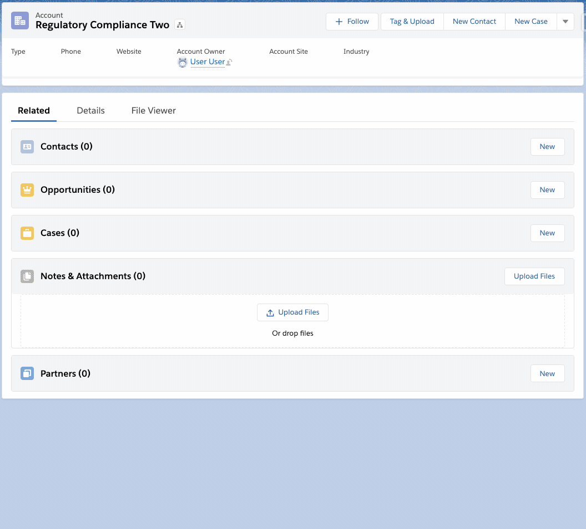

## Search and Filter

Driven by your organization's values. Filter by picklist values, lookups, checkboxes, number ranges and relative dates such as "last quarter", or flip any filter to **Is Null** to find files that are missing a tag.

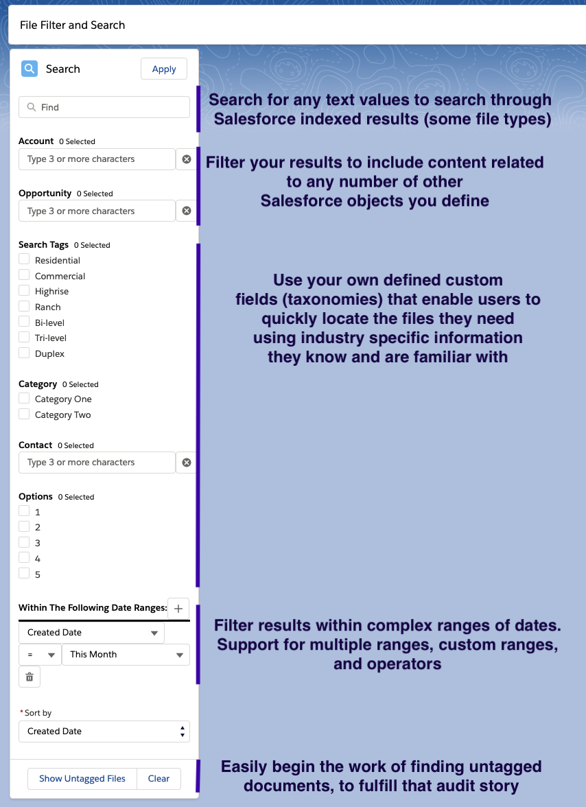

## Read Documents Without Leaving the Record

The scalable viewer opens images, PDFs, Office documents, video and audio directly on the record page. Users read contracts, inspect drawings and check scanned forms where they are working, instead of clicking into a preview modal or navigating to the file's own page and back. Resize the viewing pane to read the fine print, then keep working on the record. Which types preview, and how, is listed in [Supported File Types](supported-file-types.md).

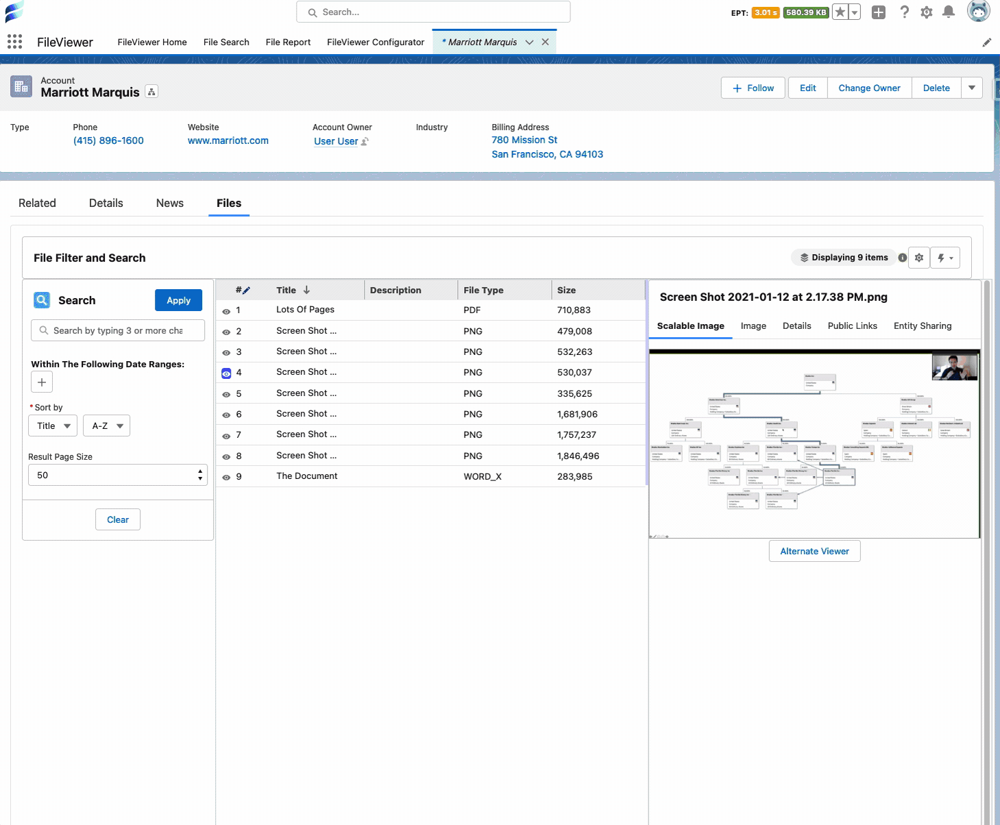

## Curated File Lists on Record Pages

Salesforce's Files related list shows every file on a record with no way to filter it. FirmWorks Files lets administrators decide which files appear and how. A [configuration](configuration.md) can limit a component to files of a certain type or tag, add files from related records such as an Account's Contacts, and present them as tabs, a carousel or tiles with [Content Viewer](component-reference.md#content-viewer). Put a "Signed Contracts" viewer on the Account page and a "Photos" carousel on the Case page, each showing only what belongs there. Each item can carry text from a field on the file, such as a description, above or below the file or on its flip side, and the filter box searches that text too.

## Bulk Actions

Run a search, click **Select Files to…**, and pick any number of files from the whole result set with search, filters, undo and keyboard support. Then edit tag values on all of them, including find and replace in text fields; link or unlink records; change the owner; create or remove public links; download the files or their data; or delete them. Every action reports the files it could not process. Files you cannot edit are marked with a lock and skipped, with a count shown before you run. Administrators enable each action per configuration. See [Bulk Actions](bulk-actions.md).

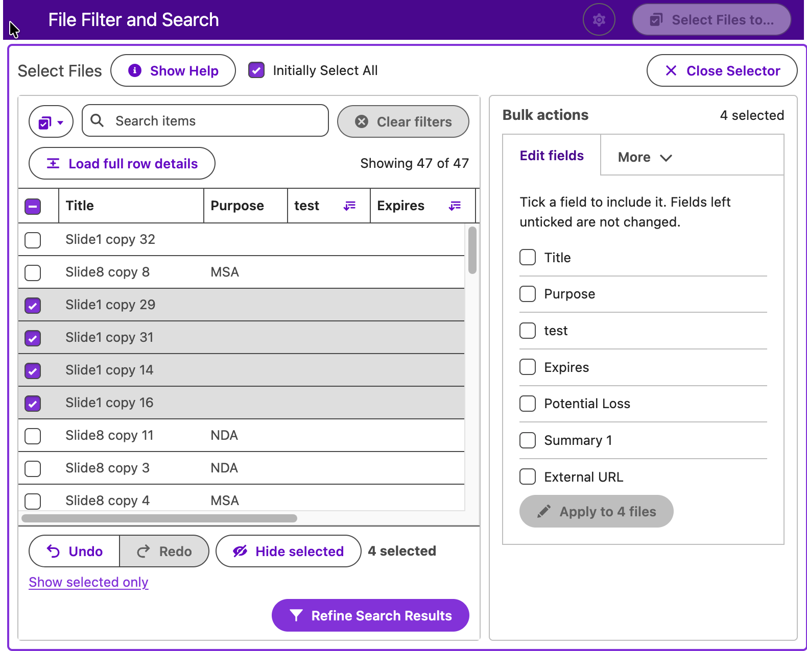

## Version History and Pruning

A **Versions** tab on each file lists every version with who uploaded it and when, opens any version in the viewer, and downloads it. When allowed, **Prune version history** keeps only the latest version, which cuts storage used by files that were re-uploaded many times. See [Versions](component-appendix.md#versions).

## Public Link Management

Create, Delete, View Content Public links easily to provide external users access. Enhances default public link experience by giving users the option to use passwords to protect links. Delete public links easily to redact access.

## Enhanced Entity Sharing Management

Create, Delete, View Content Document Link records directly on the layout. Easily create links to any object record in Salesforce more than just users.

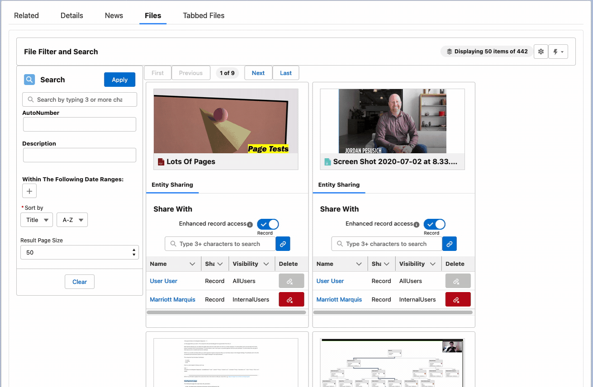

### Suggested Links To Records

Enable your users to quickly give access to related records using suggested links.

Suggested links look at the currently linked records to the file and gives a one click option to create relationships to related records.

Example - This file was linked to an opportunity. By using a FirmWorks Files configuration the suggested path of 'AccountId' is used to suggest the Account 'DIA' for the Opportunity 'DIA'.

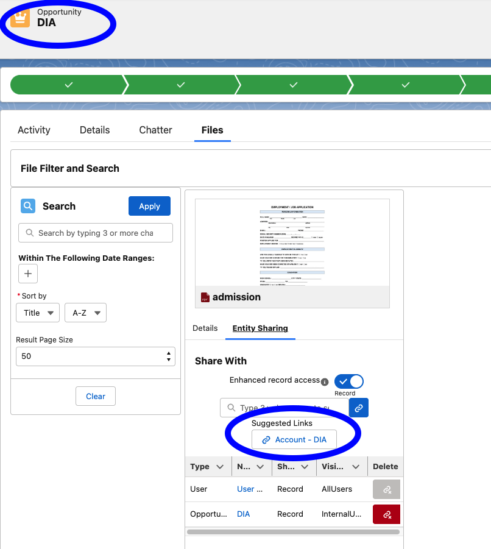

After the Account 'DIA' is linked to the note, the child contact records are then suggested.

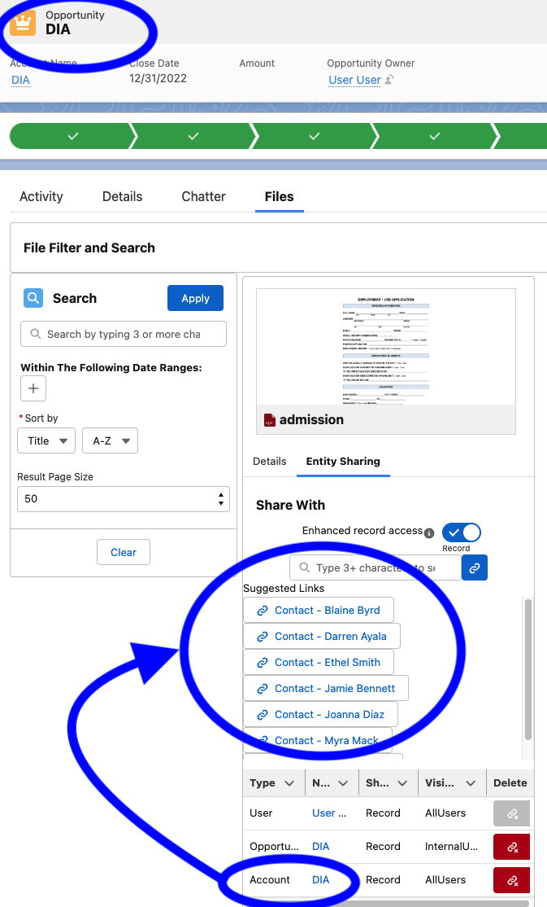

## Enhanced Upload

Upload hundreds if not thousands of files at once, with duplicate detection, versioning, size limits and per-file progress.

[Enhanced Upload](enhanced-upload.md)

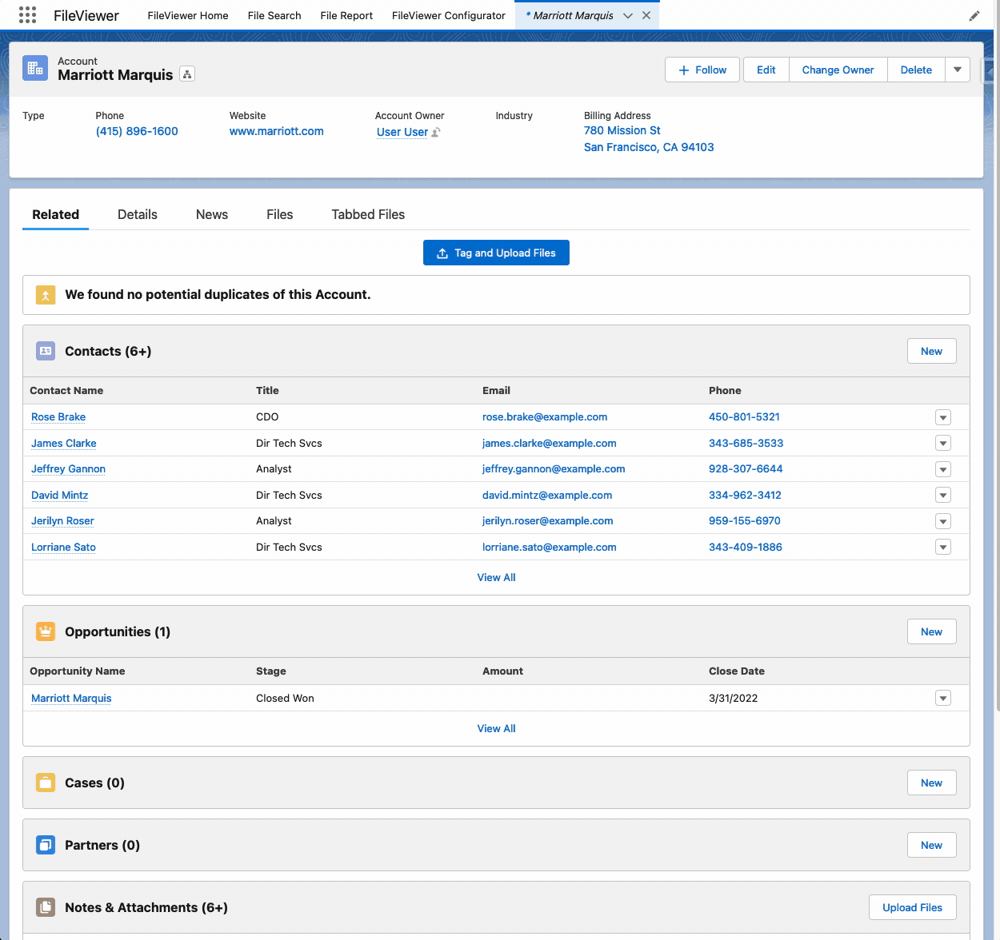

## Tag and Update Existing Documents Quickly and Easily

Quickly and easily work with your existing files and documents to give them the metadata they need to report, find, sort, and work with them going forward. With support to use the last edited value to quickly update files, and [bulk actions](bulk-actions.md) to tag hundreds at once.

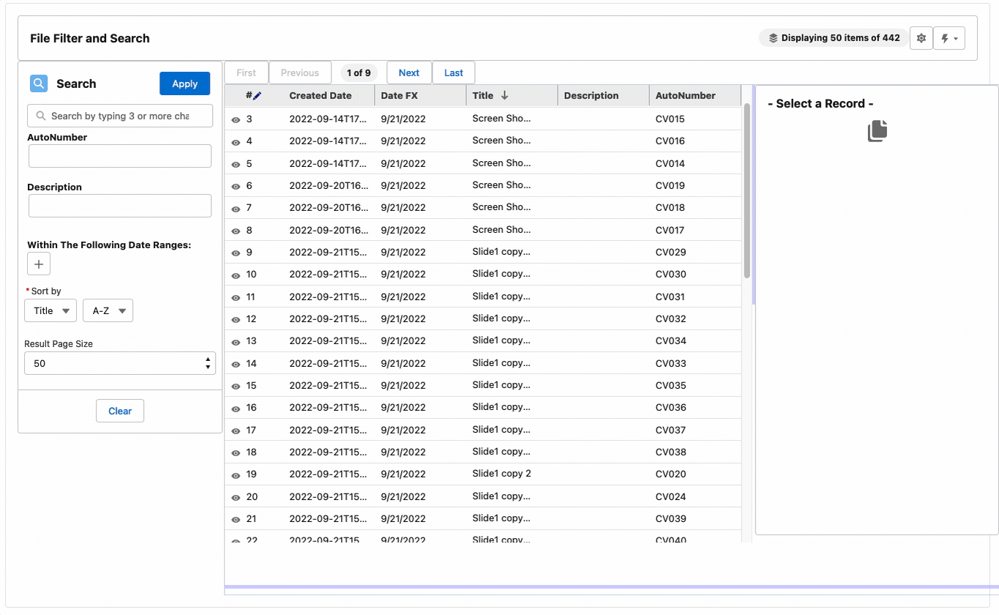

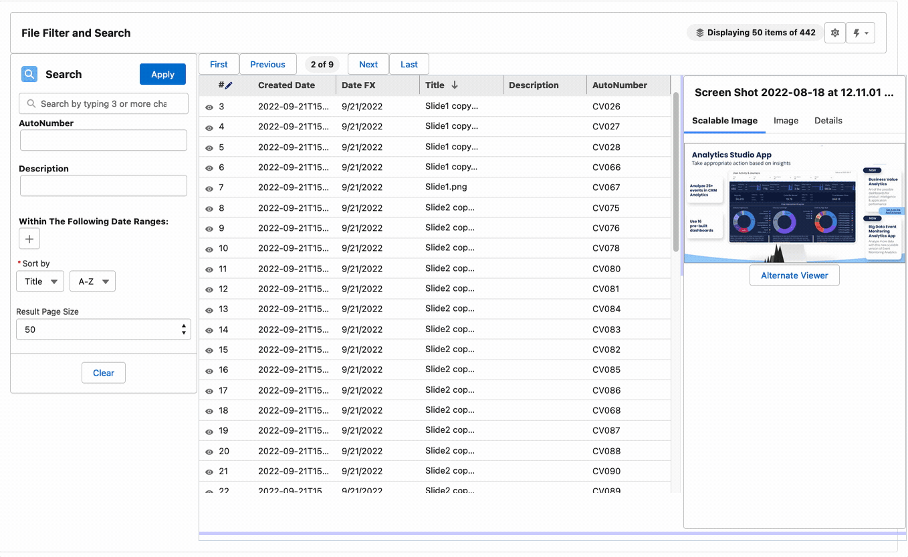

## Enhanced Flow Support

Guide users and customers through a flow to upload files as part of a process and use reporting to validate that the files exist before moving on to future steps. Each flow component has a property editor that accepts a flow variable, formula, constant, text template or same-screen component for any setting, and most settings are [reactive](fileviewer-and-flow.md#reactive-settings) to changes on the screen.

## Tabbed Viewer

Load viewable file content directly on the screen so users do not have to navigate away from the record they are on.

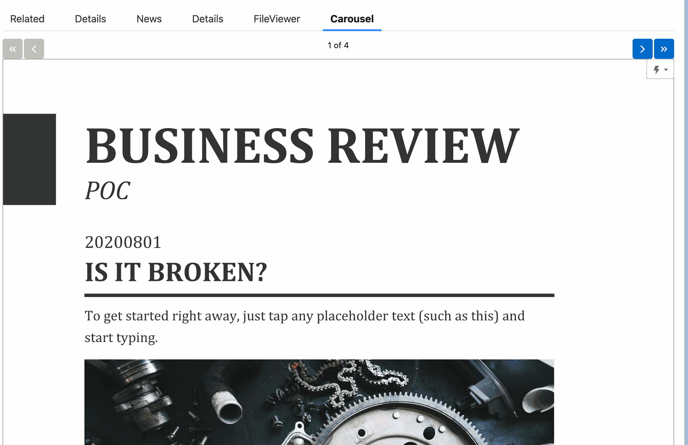

## File Reporting

Report on files and their field values - something not currently available in Salesforce

This example looks for all Accounts where an opportunity has been set to Closed Won within the last fiscal quarter, that also have a file title with 'MSA' in it (we recommend using picklists in practice). The power here is that not only can you find Accounts in Compliance with your legal standards - you can quickly find Accounts that are OUT of compliance as well by switching to Records without documents.

Reports can include public link statistics for every document: how many links exist, how often they were viewed and downloaded, and when. Results open in a sortable grid that exports to CSV, including the text of any notes in the results, and the same grid can be placed on any page or flow screen as [File Report Results](component-reference.md#file-report-results).

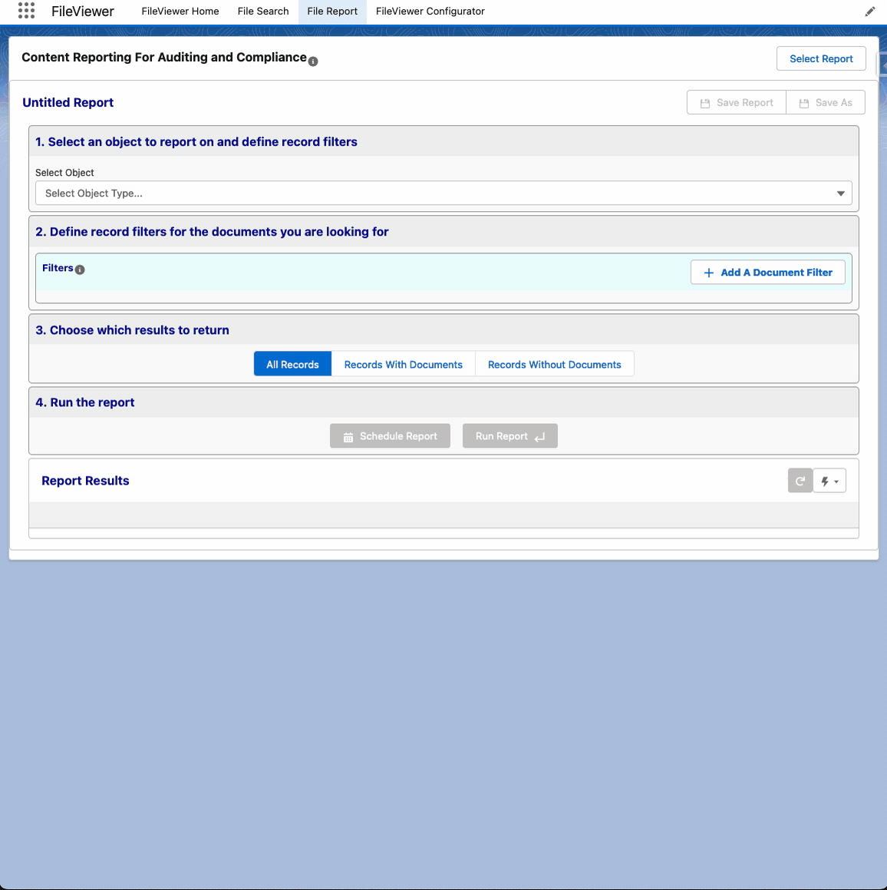

## File Auditing and Compliance

Reports can be built to your exacting requirements and scheduled to run on your schedule. Scheduled reports produce Salesforce Platform Events that can be used to drive the behavior and activities required to keep your company in compliance.

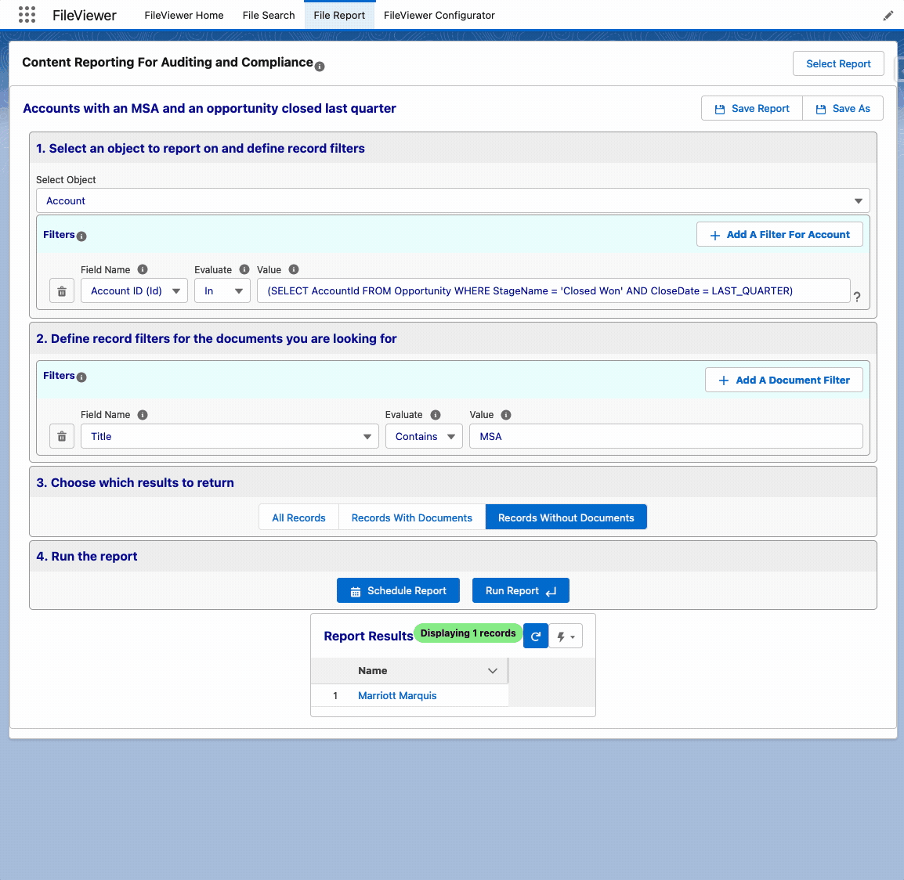

## Record Reports

Save a report and drop the [Record Reporter](component-reference.md#record-reporter) component on a layout to alert your users when documentation is missing, with your own message and a link to the documents that satisfied the report. The same component works on flow screens and can block the flow until the documents are in place.

## Related Records Search

See the files of related records without leaving the page. From an Account, include the files of its Contacts, Opportunities and Cases, or any custom relationship, by defining schema paths in a configuration. Users pick the related records in File Manager's search panel, or the administrator includes them automatically. See [Searching Related](configuration.md#step-9-searching-related).

## Run Reports Inside File Manager

Saved File Reports can be run from File Manager's search panel. The report's documents become the result set, ready to filter, tag, share or download. Administrators choose which reports are offered.

## Browser Viewer

When Salesforce cannot generate a good preview, **Show In Browser's Viewer** streams the file to the browser and lets it render the file directly. Large PDFs, video, audio, HEIC photos and Files Connect external files all open in place.

## Conditional and Required Tag Fields

Require tag fields on upload, make fields read-only, and show a field only when another field has a given value, for example show Contract Type only when Category is Legal. All of it is set in a configuration without code. See [Configuration](configuration.md).

## Share a Search

One click turns the current search, filters and sort into a URL that can be bookmarked or sent to a colleague.

## Files Dashboard

One page that shows how FirmWorks Files is set up in the org: file and data storage, license seats and expiry, who holds which permission sets, how many configurations, reports and schedules exist, which flows and triggers act on files, how many Lightning pages carry FirmWorks components, and how many files have no tags at all. Each tile links to where the item is managed. See [Files Dashboard](files-dashboard.md).

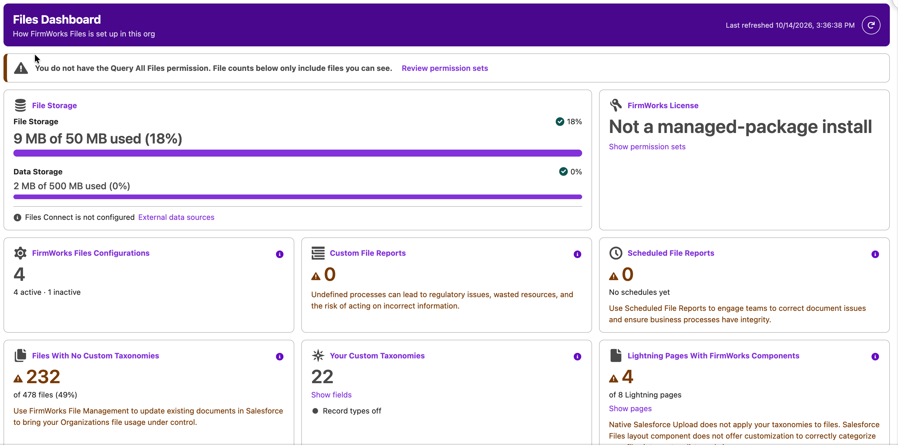

## FirmWorks Notes

A note editor built on Salesforce Notes with autosave, tags, search, version history with side-by-side compare and restore, one-click conversion to PDF, and a spreadsheet export of note text with tags through File Reports. See [FirmWorks Notes](notes.md).

## Built as Lightning Web Components

Every component is a Lightning Web Component, for faster pages and native Flow Builder property editors. Pages built on the earlier Aura components keep working, and the **Component Tools** tab finds every one of them and replaces them in place. See [Upgrading to Lightning Web Components](component-tools.md).

## Languages and Mobile

All user-facing text is available in English, Spanish, Spanish (Mexico) and French. File Manager has a layout for the Salesforce mobile app, and multiple FirmWorks components on one page refresh each other after uploads, edits and deletes.
