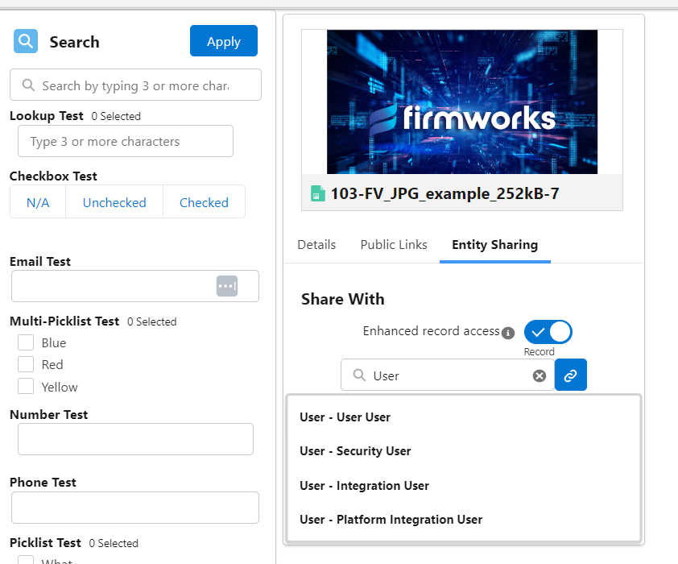
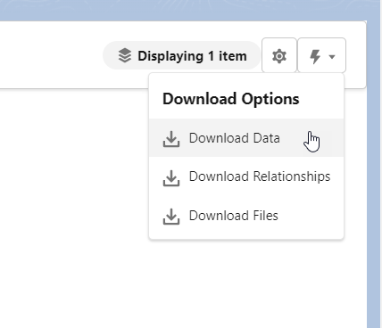
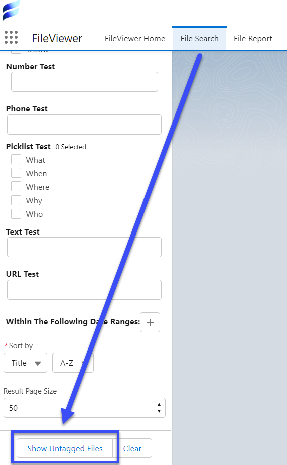

[Back To Documentation](index.md)

# Historical File Clean-up Help

1. [Finding Untagged Files](#finding-untagged-files)
1. [Tagging Files in Bulk](#tagging-files-in-bulk)
1. [Adding Collaboration Users](#adding-collaboration-users)
1. [Using List View to Update Tags](#using-list-view-to-update-tags)
1. [Dataloader to Mass Tag Files](#dataloader-to-mass-tag-files)

One of the most common activities FirmWorks Files Customers have is tagging historical files that were uploaded to Salesforce before they started using FirmWorks Files. While we cannot offer a time machine we can suggest some best practices.

## Finding Untagged Files

The [Files Dashboard](files-dashboard.md) tile **Files With No Custom Taxonomies** counts the files where every custom tag field is empty and warns when they exceed 1% of all files. Clicking it opens the File Search tab with every filter set to Is Null, so the results are exactly those files. You can also get there from File Manager's search panel: turn on **Advanced** and click **Search All Null Values**, or set individual filters to **Is Null** to find files missing one particular tag.

Counts and results respect sharing. An administrator cleaning up the whole org needs the **Query All Files** permission; see [Adding Collaboration Users](#adding-collaboration-users).

## Tagging Files in Bulk

With the untagged files on screen, click **Select Files to…**, select the files that share a classification, open the **Edit fields** tab, tick the fields to set, and apply. Repeat for the next group. Text fields support find and replace, and **Revert last edit** undoes a mistake. The same selector links files to records and changes owners. The administrator must enable these actions in the configuration first. See [Bulk Actions](bulk-actions.md).

For a handful of files, the list view below is quicker. For tens of thousands, a data loader may still be the better tool.

## Adding Collaboration Users

Content Document Links (CDLs) can be created referencing any object. Generally we use CDLs to connect Salesforce records such as Account, Opportunity, Case and more. But we can also use CDLs to give access to people to tag pre existing documents they may not normally see.

### Individual File Access

To do this in for individual files use the FirmWorks Files Component and A configuration that allows the Entity Sharing Tab. Here you can link the file to a user. Make sure to give them Record access so they can edit tags.

### Bulk Files Access

To do this en masse you will need to use a data loading tool to create CDLs for all the team members who need access to documents.

Each CDL will need the Content Document Id, the User Id and will need to default the Share Type to I (Record). You can choose whatever you like based on your orgs preferences for Visibility, but those 4 fields need to be set on the CDL to successfully upload.

You can use the File Search tab in the FirmWorks Files app to search and download all of the Content Document Ids: click **Select Files to…**, select the files, and use **Download Data** on the Download tab.

Use **Search All Null Values** in the search panel's Advanced mode to show all untagged files in your org.

## Using List View to Update Tags

Once your users have access to the historical Files you can use the File Manager List View to easily update the tags for those files. This is one of the fastest ways to update files for those without access to Salesforce data loader tools, and **Use Last Modified Values** carries each value you enter to the next row. For more information on the List View please click [here](component-appendix.md#list-view).

## Dataloader to Mass Tag Files

Similar to how you can use Salesforce data loading tools to create CDLs to grant access to tagging files you can also use them to update tags for documents in bulk. Generating a file from Download Data will also pull out all the fields you can tag into the excel. Here you can set up a csv to use with data loading tools. There are a plethora of ways to load data and Salesforce has a lot of best practices so please use the following articles to make the best choice for your needs.

- [Data Management Trailhead](https://trailhead.salesforce.com/content/learn/modules/lex_implementation_data_management)
- [Data Import Best Practices](https://www.salesforceben.com/6-best-practices-for-importing-data-into-salesforce/)
- [Large Data Volume Trailhead](https://trailhead.salesforce.com/content/learn/modules/large-data-volumes)
- [Best Practices for Large Data Deployments](http://resources.docs.salesforce.com/latest/latest/en-us/sfdc/pdf/salesforce_large_data_volumes_bp.pdf)