[Back To Documentation](index.md)

# File Reporting

## Configuration and Setup

All System Administrator based profiles can see the File Report tab after installation. To allow other users to see the tab you will need to assign them the **FirmWorks Files Reporting** permission set, or the **FirmWorks Files Reporter** permission set group (see [Permissions and Licensing](permissions.md)). To assign a permission set please follow the documentation from Salesforce (https://help.salesforce.com/s/articleView?id=sf.perm_sets_assigning.htm).

## Using Select Reports

Start off by clicking the Select Reports button to see some out of box reports based on standard Sales Cloud objects (Accounts, Contacts, and Opportunities).

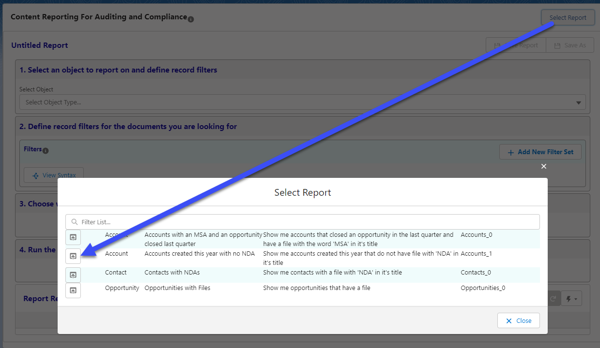

Once the Reports UI is open click the load icon to the left of a report to fill in the criteria in the sections below.

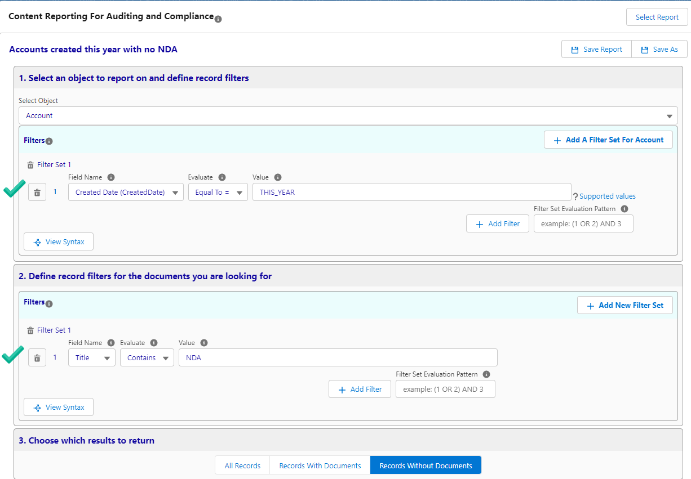

Clicking Run Report will return results from your org based on the filters established by the Quick Report selected.

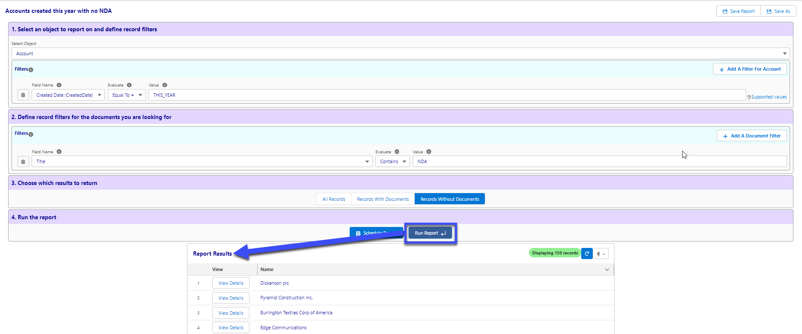

From here you can save reports, add/remove filters, change the record to return criteria, and interact with result records.

### Saving Reports
There are two buttons on the top right of the Reports section that will save the current filters. This will start a save event that will commit the report to the database and make it available in the Quick Reports menu. The report header shows "(unsaved changes)" while there is something to save.

1. Save Report - This will save the report under the existing name. If it is a new report it will ask you to input a name and a report description.

1. Save As - This will open the UI to save a new report regardless if the report exists or not.

A saved report has two names:

- **Report Title** is what people see. It must be unique.
- **Report Identifier** is the API name that components, flows and the File Report Event use to reference the report: letters, digits and single underscores, starting with a letter, up to 40 characters. **Use suggested** derives one from the title. It is assigned when the report is first saved and cannot change afterwards, because other components reference it. Saving a report whose identifier is already taken shows "A report with the identifier ... already exists". **Copy Report Identifier** puts it on the clipboard for use in a flow.

**New Report** clears the builder to start again; it asks before discarding unsaved changes.

### Adding or Removing Filters

To add a filter to the Selected Object in Step 1, click on the Add a Filter For <Selected Object Label> button on the top right. Once the filter row has been added, select the field from the Field Name selection, choose an Evaluation criteria, and set a value. For more help on supported values click the question mark at the end of the row.

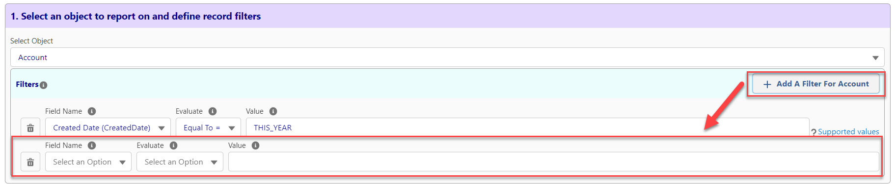

The value control depends on the field:

- **Picklist fields** with In, Not In, Includes or Excludes open a value picker where you tick one or more values. Every such filter needs at least one value before the report runs.
- **Date and date/time fields** take a **Kind of date value**: a relative period such as Last Month, This Fiscal Quarter or Next Week; an N-based period such as Last N Days with a whole number for N; a **Specific date** or **Specific date and time**; or a **Custom SOQL value** typed verbatim. A **SOQL** preview shows what the filter will evaluate, and the row is highlighted until the value is valid.
- **Other fields** take a typed value. Leave it empty for a null filter.

**Edit columns** chooses which fields appear in the results and the export. "No columns selected" means the results will show only the record name.

You can also change the Selected Object by using the Selected Object drop down. This will remove all of the current filters, so make sure to save your changes before modifying the Selected Object.

To remove a filter click the trashcan next to the filter row you wish to remove.

Follow the same steps above to add or remove a filter from the tagged documents section in Step 2.

### Advanced Filtering

#### Filter Sets

Using Filter Sets, File Reporting can be even more powerful. A Filter Set represents a set of criteria for a single Salesforce object or File you want to include in your report.

When used in Section 1 of a report a Filter Set functions as an additional way of grouping filters on a single object. This allows for more comprehensive filtering using AND and/or OR on your chosen object.

When used in Section 2 of a report a Filter Set represents the same thing but there is also another option you can use to track multiple documents as part of a single report. For example, if you wanted to see if an account has both a file tagged as an NDA and a file tagged as an MSA based on a picklist tag field, you would do the following.

First set up a Filter Set where your criteria is Picklist equal to = NDA. Click + Filter Set and add a Second set with the criteria Picklist equal to = MSA. Finally change your operator to And Has. The And Has operator will check for multiple Files for a given object.

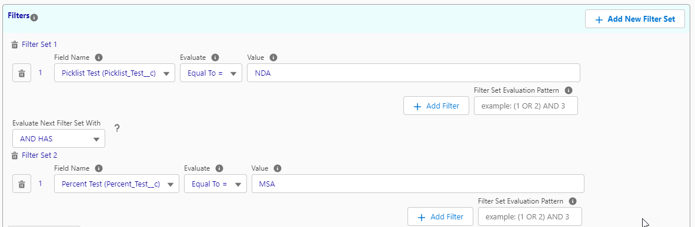

#### Filter Set Evaluation Pattern

You can use this box in a Filter Set to determine how your logic evaluates. If all the operators between your criteria are the same you can use the drop down to set the operator. If your logic needs to change between nodes you can type your custom logic in the Filter Set Evaluation Pattern box, for example `1 AND (2 OR 3)`. Once you type logic in this box the Drop down list will disappear since they are no longer relevant. To get them back remove your custom logic.

The pattern is checked before the report runs. Use only filter numbers, AND, OR and NOT with spaces around them, close every parenthesis, and use each filter number exactly once. The message under the box names any number that is missing, repeated or not a filter. The **AND** and **OR** buttons beside it rewrite the pattern so every filter is joined by that operator, which is the quickest way to recover from a broken pattern.

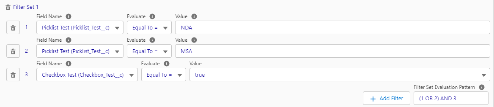

#### View Syntax Button

This button can be clicked at any time to show you the current logic you are using in your filter. **Copy SOQL** puts the generated query on the clipboard for use in Developer Console or Workbench.

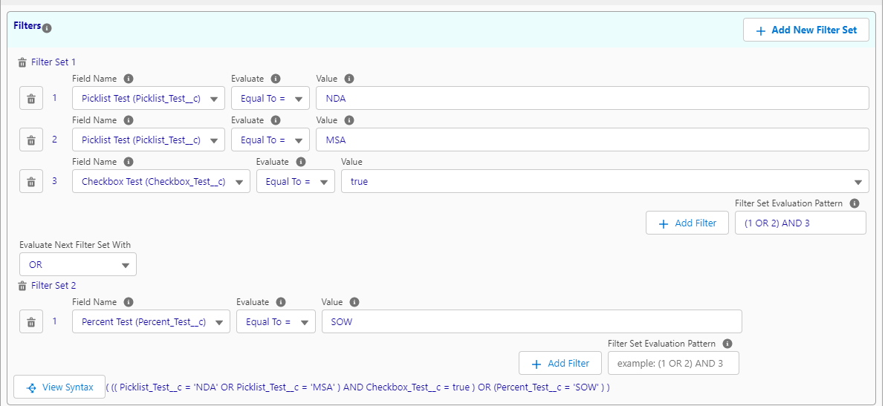

If you are using the And Has operator the syntax will show a set of criteria for each Filter Set separated by a comma.

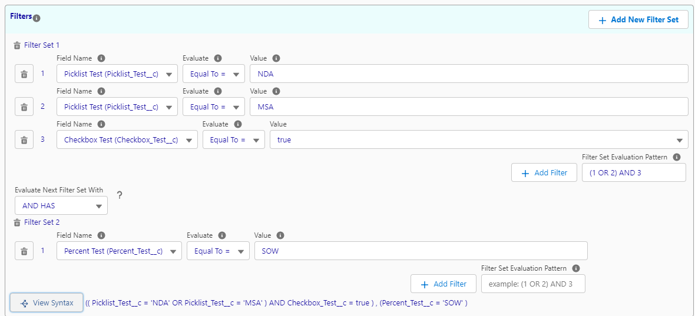

### Record Return Criteria

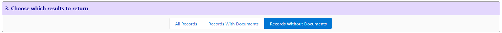

The buttons in Step 3 will allow you to change the returned record set.

- **All Records** - This will return all records that fulfill the selected object criteria in Step 1.
- **Records With Documents** - This will return all records that fulfill the selected object criteria in Step 1 and have documents that meet the criteria in Step 2.
- **Records Without Documents** - This will return all records that fulfill the selected object criteria in Step 1 and do not have documents that meet the criteria in Step 2.

### Results Buttons

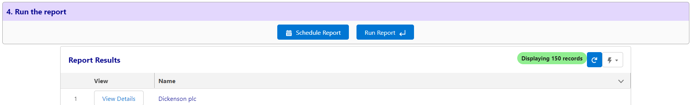

- **Schedule Report** - This will allow you to schedule a report to drive business process based on the returned results. For more see the [Scheduling Reports](#scheduling-reports) section below
- **Run Report** - Runs the report and fetches the result set again, capturing any new records that meet the criteria. The button is disabled while a run is in progress.

The results are shown by the [File Report Results](component-reference.md#file-report-results) grid, the same component you can place on a page or flow screen. Its **Refresh** button re-runs the report and **Stop Running** cancels a run, keeping the rows fetched so far. A badge shows progress, such as "Getting records, please wait... 4,000 records, page 2", and then "Displaying N Records". Every column sorts. The **Name** column opens the record, and in the Details view **Title** opens the document. A pager below the grid shows "Rows 1-100 of 2,340", switches between **Pages** and **Scroll**, and sets **Results Per Page**.

The grid's actions menu:

- **Download Data** - A CSV of every row in the current view with every column, named after the report. Excel opens it directly.
- **Download Current Page** - A CSV of only the rows on screen. Offered when the grid is not already showing everything.
- **Download Data With Note Contents** - In the Details view, when the results include notes: the same CSV with a **Note Contents** column holding each note's text. See [Exporting notes with their tags](notes.md#exporting-notes-with-their-tags).
- **Download Files** - Downloads every document in the results as zip files. Files are requested in batches of 800, each as its own zip; a dialog lists the links in case a pop-up blocker stops one.
- **Show In FileViewer** - Opens the documents in the File Search tab, where they can be filtered, tagged, shared and acted on in bulk.

If a run fails, the error shows above the grid with a **Copy error** button for a support request.

### Grouped and Details Views

Results can be shown **Grouped**, one row per record of the selected object with its documents summarised, or as **Details**, one row per record and document with the document's tag fields as columns. The CSV download follows the view you are in, so switch to Details and include the file fields you need in Step 2 to see them in the export. The File Report Results component can default to either view, and each user's last choice is remembered per report.

### Include View Statistics

Tick **Include View Statistics** in Step 2 to add public link columns to every document row in the Details view and the export:

| Column | Meaning |
|---|---|
| Public Links | Number of public links ever created for the document. |
| Active Public Links | Links that have not expired or been deleted. |
| Public Link Views | Views through public links. |
| Internal Views | Views by Salesforce users. |
| Public Link Downloads | Downloads through public links. |
| Internal Downloads | Downloads by Salesforce users. |
| First Public Link View, Last Public Link View | When the document was first and last viewed through a link. |
| Last Public Link Download | When it was last downloaded through a link. |
| Public Link | The URL of the newest link. |

Use it to find documents that are shared externally but never opened, or links that should be removed. Counts come from Salesforce's Content Distribution records; in orgs where those are unavailable the columns show zero or blank rather than failing the report.

### Reporting on Libraries

When the selected object is Library (ContentWorkspace), the Details view adds Content Folder Path, Content Folder Name and Content Folder Id so library administrators can see where each file sits. Salesforce does not provide a link to a folder, so these columns are the way to locate one.

## Scheduling Reports

### Basic Scheduling
Scheduling reports will allow a report to be run regularly and post a platform event. To learn more about which Salesforce technology can subscribe to platform events please see the following Salesforce Article, https://developer.salesforce.com/docs/atlas.en-us.platform_events.meta/platform_events/platform_events_subscribe.htm.

To start click the Schedule Report button to access the scheduling UI. The report must be saved first. This UI will open the scheduling UI for the current report but will also allow you to set Schedules for all the saved reports in the org. The **Scheduled Reports** list shows every schedule with its report and next run time; the [Files Dashboard](files-dashboard.md) summarises the same list.

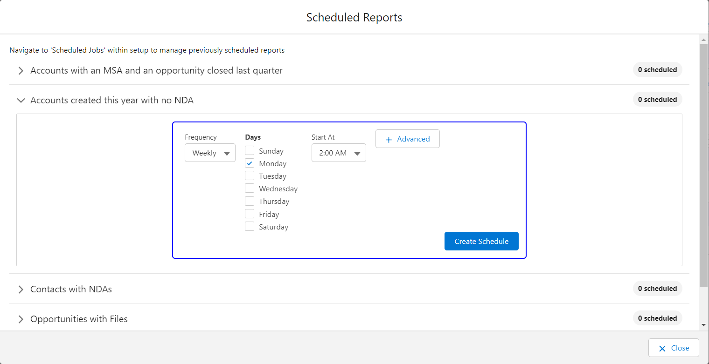

- Frequency: There are two options for Frequency, Monthly and Weekly.
- Days: This is a multi-select list that lets you pick one or more days for the schedule to run on.
- Start At: This is the time the schedule should run at the frequency and days you chose previously.

At this point you can click Create Schedule to generate a scheduled job for the report with the setting you choose. You can generate more than one scheduled job for a report if needed.

### Advanced Scheduling

The Advanced button in the scheduling UI allows a user to input their own cron expression or have the choices build one. Once the advanced button is set the cron expression is no longer going to affect the choices (they are greyed out to indicate this)

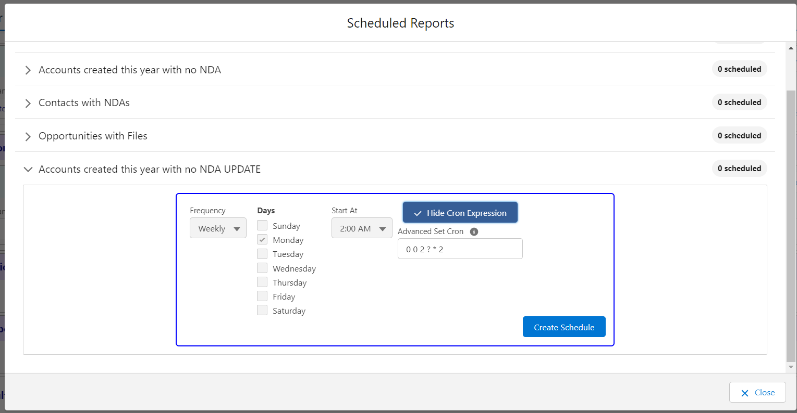

## Using Flows to Automate Action From on Scheduled Reports.

Scheduling a File Report results in a Platform event being published for each returned from the report. You can subscribe to these events by using a Platform event triggered flow. To setup a Platform Event Triggered Flow use the Salesforce documentation here https://developer.salesforce.com/docs/atlas.en-us.platform_events.meta/platform_events/platform_events_subscribe_flow.htm. When asked which platform event you
want to choose select File Report Event as seen below.

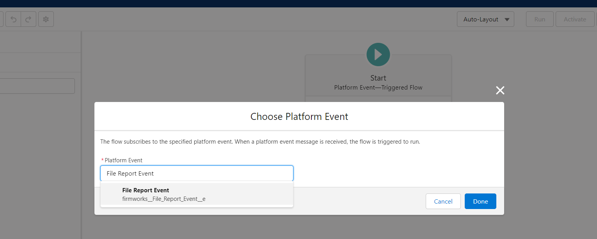

The File Report Event allows access to the following information for use with the flow:

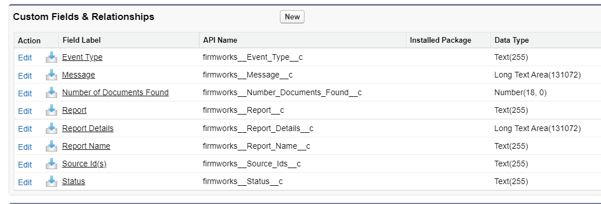

- Event Type: This value is currently set to "Report" to indicate where the event was sourced from. It may be updated with new values in the future.

- Message: This field will be populated with any system error messages that happen

- Number of Documents: This is the Number of Document associated with the record that was returned from the report for this Platform event. If the report is set up to return records without documents this will be 0.

- Report: The Id of the Metadata record associated with the report that created the Platform event.

- Report Details: The Description field from the Metadata record associated with the report that created the Platform event.

- Report Name:The name (Custom-<scheduled Job Id>) of the Scheduled Job Associated with Report Schedule.

- Source Id(s): The Id of the record returned from the report that created the platform event.

- Status: Blank unless there is an issue.

These fields are available from the Record object when using the elements in a flow. Generally, using the Source Id(s) field to get records to update is a good way to go. Some use cases are:

- Updating a field on a record when a document exists or does not exist.

- Creating a Task or Chatter on the Source Id(s) record to alert the owner action is needed.

Alternatively you can also use the [Record Reporter](component-reference.md#record-reporter)

## Running Reports from File Manager

A [FirmWorks Files Configuration](configuration.md#step-4-filtering) can add a Reports section to File Manager's search panel. Users pick a saved report, run it, and the report's documents become the search results, which they can then filter further, tag, share, download or act on with [bulk actions](bulk-actions.md). The configuration chooses which saved reports are offered.

## Reports in Flows

- **Record Reporter** shows a record's compliance on a flow screen and can block Next or Finish until the report passes. See [FirmWorks Files and Flows](fileviewer-and-flow.md#record-reporter).
- **File Report Results** on a flow screen takes a list of record Ids in **4. Data: Run for these Record Ids**, for example every Contact on an Account, and shows which are missing documents. Bind the setting to a text template that joins a collection with commas. Its **Report Result** output is the number of records returned, for a Decision element after the screen.
- **Get FirmWork's File Report Results** is an invocable action that returns whether one record is in a report's results, for use in any flow without a screen. See [Flow Templates and Invocable Actions](flow-templates-and-actions.md#get-firmworks-file-report-results).

## Creating Custom Reports

Instead of using Quick Reports, a custom report can be created to store reports for specific business needs. The builder has four steps:

1. **Choose an object and the records to report on**: the object, the columns to show, and the record filters.
2. **Narrow by the documents attached to those records (optional)**: document filter sets, the document columns to show, and Include View Statistics.
3. **Choose which records to return**: All Records, Records With Documents or Records Without Documents.
4. **Run or schedule the report.**

You can save this report for future use using the same steps in the [Saving Reports](#saving-reports) above.

___

[FirmWorks Files FAQ](https://getfirmworks.com/#faq)

For FirmWorks Files Support, please contact <support@getfirmworks.com>
