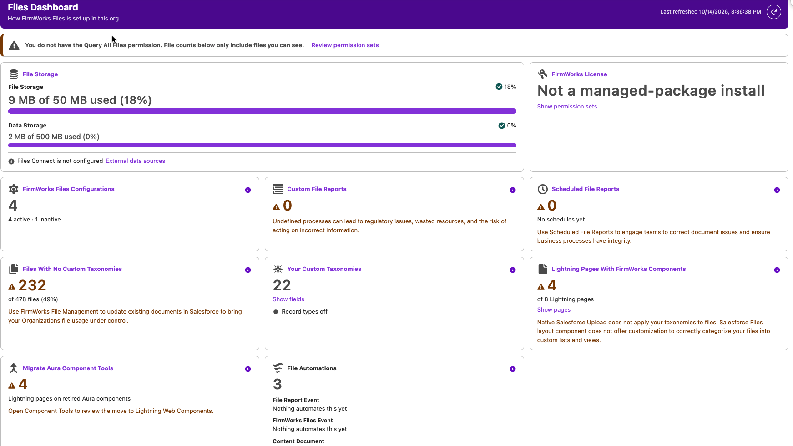

[Back To Documentation](index.md)

# Files Dashboard

The **FirmWorks Files Dashboard** tab shows how FirmWorks Files is set up in your org on one page. Each tile reports a count or a meter, warns when something needs attention, and links to the place in Setup or in the app where it is managed. Nothing on the dashboard changes data.

- [Who can see it](#who-can-see-it)
- [Where it appears](#where-it-appears)
- [Reading the dashboard](#reading-the-dashboard)
- [Tiles](#tiles)
- [Limitations](#limitations)

## Who can see it

The dashboard is granted by the **FirmWorks Files Configurator**, **FirmWorks Files Reporting** and **FirmWorks Files Component Tools** permission sets, and therefore by the **FirmWorks Files Admin** and **FirmWorks Files Reporter** permission set groups. The base FirmWorks Files permission set and the FirmWorks Files User group do not include it. See [Permissions and Licensing](permissions.md).

File counts respect sharing. A banner at the top says whether the user has the **Query All Files** permission:

- "You have the Query All Files permission. File counts below cover every file in the org."
- "You do not have the Query All Files permission. File counts below only include files you can see." with a **Review permission sets** link.

Query All Files is separate from Modify All Data. An administrator with Modify All Data still sees the second message until Query All Files is granted. See [Permission Set to Query All Files](known-issues.md#permission-set-to-query-all-files).

## Where it appears

The dashboard is the second tab in the **FirmWorks Files** app. To add it to another app, use Setup > App Manager > (app) > Navigation Items, as described in [Additional Setup](advanced-config.md#adding-the-firmworks-files-tabs-to-an-app).

The component **FirmWorks Files Dashboard** can also be dropped onto any Lightning App Page or Home Page in Lightning App Builder. It has no settings. It is not available on record pages or in Experience Cloud.

## Reading the dashboard

- Tiles load independently. Each one appears as its data arrives, and the **Last refreshed** time updates as they finish.
- **Refresh** re-queries everything. It is disabled while any tile is still loading.
- A tile that could not load shows "Could not load this metric" or the error. A metric that partly failed lists the problem above the grid and the other tiles still render.
- Each tile's title is a link that opens the related tab or Setup page in a new browser tab, so the dashboard stays where it is.
- Tiles use three states. A green check means fine. An amber warning icon and amber value mean attention is suggested. A red error icon means something is critical. Meters change colour the same way and always show the percentage as text.

## Tiles

### File Storage

Two meters from the org's limits. **File Storage** is the large one, with "N of M used (P%)". **Data Storage** sits beneath it. Values are in MB below 1 GB and GB above. A meter turns amber at 70% and red at 90%. Both meters always appear. If the org does not report a limit, the meter says "N used, limit unavailable" when usage is known, or "Storage usage unavailable", and shows no status icon. If the storage request fails, the error appears beneath the meters; the rest of the dashboard still loads.

Below the meters, the tile reports whether **Files Connect** is set up: "Files Connect is configured: N external data source(s)", listing each source and its type (SharePoint Online, Google Drive, Box, Quip, OneDrive and so on), or "Files Connect is not configured". The **External data sources** link opens Setup.

Opens **Storage Usage** in Setup.

### FirmWorks License

The headline depends on the license:

- "N of M seats used" for a seat-limited license, turning amber when every seat is used.
- "N licensed users" and "Site-wide license" for an unlimited license.
- "Not a managed-package install" in a development org where the package is not installed.

The second line shows "Expires date", "Expired date" (red) or "Never expires". The tile warns 30 days before expiry.

**Show permission sets** expands a list of every FirmWorks permission set group and permission set with its number of active assigned users, counting users assigned directly or through a group. Each row links to the record in Setup.

Opens **Installed Packages** in Setup.

### FirmWorks Files Configurations

The number of active [configurations](configuration.md), with "N active" and "N inactive" beneath. Warns when there are none.

Opens the **FirmWorks Files Configurator** tab.

### Custom File Reports

The number of saved [File Reports](file-reporting.md). Warns when there are none.

Opens the **File Report** tab.

### Scheduled File Reports

The number of schedules across saved reports, with "across N reports" and "next run date" showing the earliest upcoming run. Shows "No schedules yet" and warns when none exist. See [Scheduling Reports](file-reporting.md#scheduling-reports).

Opens the **File Report** tab.

### Files With No Custom Taxonomies

How many files have no tag values at all, with "of N files (P%)". A file counts as untagged when every filterable custom Content Version field is empty, checkboxes included. Formula fields are not considered. The tile warns when more than 1% of files are untagged.

Both counts stop at 50,000 and then display "50,000+", so the percentage in very large orgs is approximate.

Opens the **File Search** tab with every custom filter field set to Is Null, so you can tag the files with [bulk actions](bulk-actions.md). File Manager's own **Search All Null Values** button also includes standard fields such as Record Type, so its results can differ. See [Historical File Clean-up](file-cleanup.md).

### Your Custom Taxonomies

The number of custom fields on the Content Version object that FirmWorks Files can use as tags. **Show fields** lists them with label, API name and type. Fields that are not filterable, such as formulas, are dimmed and marked "not counted for untagged files". The tile warns when there are no custom fields.

The footer reports "Record types on: N" or "Record types off". When record types are on, a **Cache record type values** link opens the Record Type utility described in [Record types on Content Version](permissions.md#record-types-on-content-version).

Opens the Content Version object's **Fields & Relationships** page in Setup.

### Lightning Pages With FirmWorks Components

How many Lightning pages place at least one FirmWorks component, with "of N Lightning pages". **Show pages** lists each page with its type and the components on it. The tile warns whenever some pages have no FirmWorks component.

This tile reads page metadata through the Tooling API, which a Lightning page cannot call directly, so it runs through a hidden Visualforce page. It needs the user to have **API Enabled**. If Salesforce's Dependency API is unavailable in the org, the page list still loads and the tile reports "Page dependency data is unavailable in this org". If the query does not answer within 30 seconds the tile reports "The page dependency query did not answer".

Opens **Lightning App Builder** in Setup.

### Migrate Aura Component Tools

How many Lightning pages still place a retired FirmWorks Aura component. Warns when the count is above zero and says "No Lightning page places a retired Aura component." when it is not.

The tile opens the **FirmWorks Files Component Tools** tab, but only for users who hold the **FirmWorks Files Component Tools** permission set plus the **View Setup and Configuration**, **Customize Application** and **API Enabled** permissions. The tile names whichever of those is missing and links to the permission set. See [Upgrading to Lightning Web Components](component-tools.md).

### File Automations

Lists the automations that act on Salesforce Content: Flows and Apex triggers on the Content Document, Content Version, Content Document Link and Content Delivery objects, and Flows subscribed to the FirmWorks platform events. The value is the total. Each entry shows its name, whether it is a Flow or an Apex trigger, and "Not running" if it is inactive. A group with nothing in it reads "Nothing automates this yet". Packaged flow templates are not counted.

A line at the top reports the [File Events](file-events.md) license: "File Events is on, so the FirmWorks Content triggers can run" or "File Events is off, so the FirmWorks Content triggers do not run". A FirmWorks trigger counts as running only when File Events is on and at least one of its switches is on in the Configurator's File Events tab.

The tile title does not navigate. The **Manage in Setup** footer links to **Flows**, **Apex Triggers** and each FirmWorks platform event.

## Limitations

- Counts respect the running user's sharing unless they have Query All Files.
- File counts stop at 50,000 per query.
- Nothing is cached. Every load and every Refresh re-runs the queries, and the two file counts scan the Content Version table, so the untagged tile is the last to appear in large orgs.
- The Lightning Pages and Component Tools tiles depend on the Tooling API and on Salesforce's Dependency API, and time out after 30 seconds.
- The dashboard is not available on record pages or in Experience Cloud.
