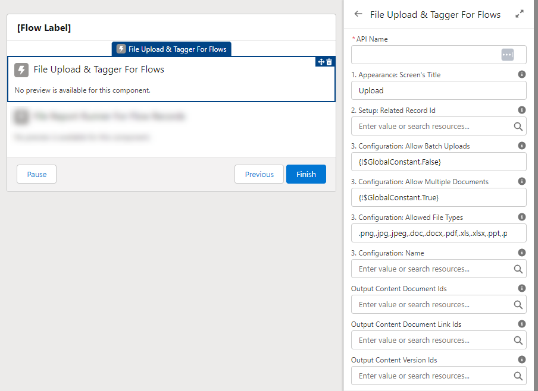
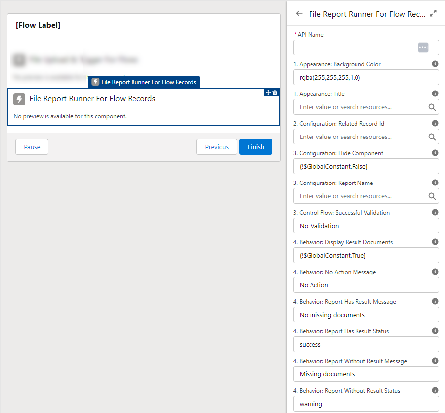
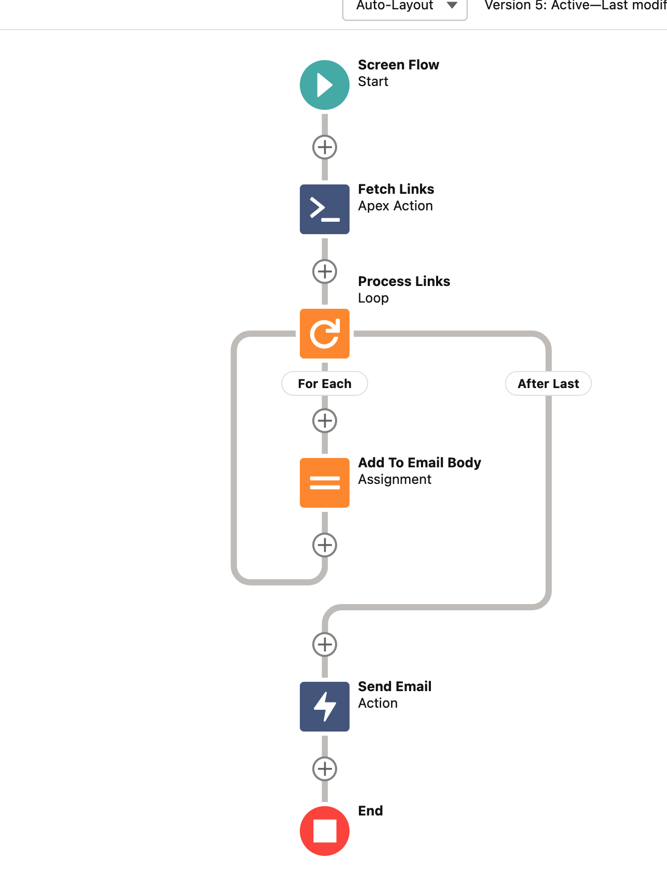
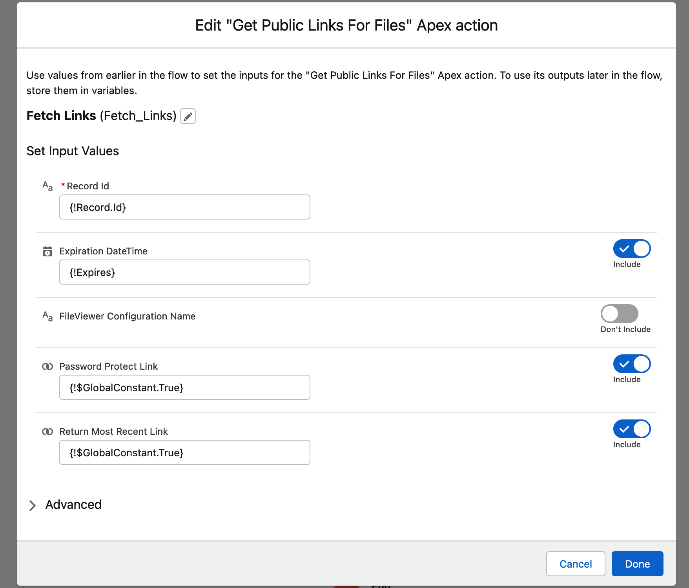
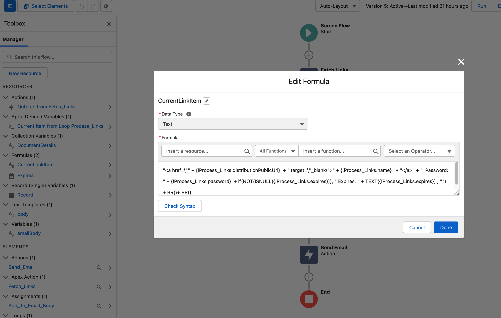
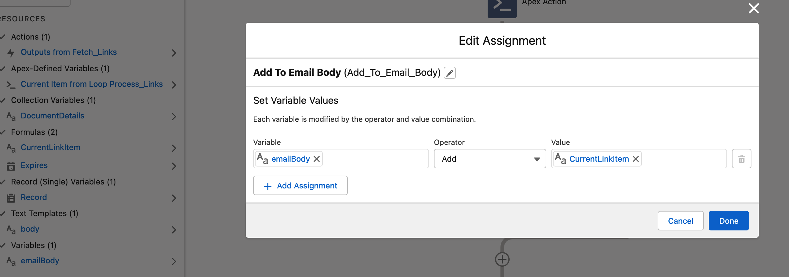
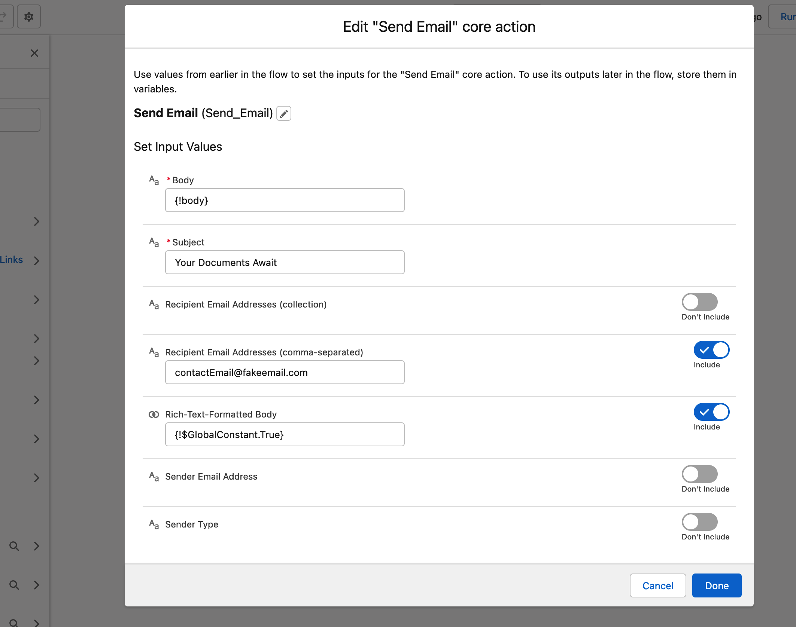
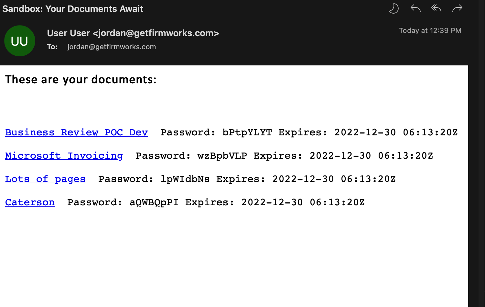

[Back To Documentation](index.md)
# FirmWorks Files and Flow

Flows are a huge part of Salesforce automation, Lots of processes that are built in flows also need to include uploading files. From applying for a loan to getting your candidates documentation, files and Flows go hand in hand. If you want to be able to tag and upload files with FirmWorks Files you can do that as well!

There are three ways FirmWorks Files can help your flows do more with files:

1. Allow users to tag and upload files and validate that the proper files have been uploaded before a user can continue the flow.

1. Create and send Public Links and email a client in order to better source control your documents.

1. React to file changes with [File Events](file-events.md) and run File Reports headlessly with the [invocable actions](flow-templates-and-actions.md).

The package ships six flow templates that show each of these patterns. Open Setup > Flows > Templates, or see [Flow Templates and Invocable Actions](flow-templates-and-actions.md).

FirmWorks File Manager, Content Viewer, File Tagger Button and File Report Results can also be placed on flow screens. Their settings are in the [Component Reference](component-reference.md).

Every FirmWorks LWC on a flow screen has a custom property editor. Settings are grouped as in App Builder, and each row has a **Use a Flow resource** toggle: off, you type a value or pick from a list; on, you choose a resource of the same type. The resource list holds flow variables, formulas and constants, text templates for any text setting, and components on the same screen whose value or output has the same type. Configuration names and report names are picklists. Most settings are [reactive](#reactive-settings), so a bound value that changes while the screen is open updates the component in place. Flows built before 2.1 use the Aura screen components, which still work; [Component Tools](component-tools.md) creates a new flow version with the LWC components in their place.


## Reactive settings

Flow screens are reactive: a component can read the value or output of another component on the same screen, and when that value changes the reading component updates while the user is still on the screen. FirmWorks Files supports this on every setting whose help text in the property editor starts with **\*REACTIVE\***. Bind one of those settings to a component on the same screen and the FirmWorks component redoes its work as the value changes: File Tagger reloads its configuration, Record Reporter runs the report again, and FirmWorks File Manager and Content Viewer fetch their files again. Setting the same value again does nothing.

Settings without the marker are read once when the screen loads. They can still be bound to a variable or to a component on an earlier screen; they just do not change while the screen is open. The [Component Reference](component-reference.md#flow-property-editors) lists which settings are reactive for each component.

Typical uses:

- A **Lookup** screen component bound to Record Reporter's **2. Configuration: Related Record Id**, so the report runs for whichever record the user picks.
- File Tagger's **Output Content Document Ids** bound to Content Viewer's **Collection of Ids**, so files are previewed on the same screen as they are uploaded.
- A **Toggle** screen component bound to Record Reporter's **3. Configuration: Hide Component**, so the user can show or hide the report detail.

Outputs of components on earlier screens behave like variables. They hold the value they had when that screen was finished.

### Seeing same-screen components in the resource list

Flow Builder passes a screen's components to a property editor only after the screen has been saved. A component you have just added or renamed on the same screen does not appear in the resource list until then. Click **Done** on the screen, then open the screen editor again and return to the FirmWorks component's settings. The note **Not seeing component outputs** at the top of each property editor is a reminder of this.

### Text templates

Any text setting can be bound to a text template. The template's merge fields are resolved when the screen runs, so the setting receives the finished text. Record Reporter's **4. Behavior: Report Has Result Message** and **Report Without Result Message** are the usual case: build a rich text template that includes record fields, bind it to the message, and the validation error names the record or the document type that is missing. File Report Results's **4. Data: Run for these Record Ids** is another: bind a text template that joins a record collection with commas to run the report for just those records. Text templates are listed with the variables, formulas and constants of the same type, ahead of the components on the screen.

## Upload and Tag Files in a Flow

In order to enable your users to tag and upload files in a flow you will need to add the FirmWorks Files Screen Components. There are two components you can use.

### File Tagger

This component is the same Tag and Upload screen as [File Tagger Button](component-appendix.md#uploading-with-file-tagger-button) opens, placed on the flow screen.



1. **API Name** - All Flow Components need this variable. It cannot have spaces.
1. **2. Setup: Related Record Id** - The record Id the uploaded files are linked to. Usually the flow's `recordId` variable.
1. **3. Configuration: Name** - A [FirmWorks Files Configuration](configuration.md) that supplies the tag fields, required fields, default values, sharing and upload settings. **Set this and leave the other 3. Configuration settings at their defaults.**
1. **3. Configuration: Allowed File Types**, **Allow Multiple Documents**, **Allow Enhanced Uploads**, **Default Upload Mode** - Upload behavior. Described in the [Component Reference](component-reference.md#file-tagger).
1. **3. Configuration: Dynamic Field Values** - JSON that presets tag values from flow variables. See below.
1. **Output Content Document Ids**, **Output Content Version Ids**, **Output Content Document Link Ids** - Text collection variables that receive the Ids of the uploaded files. Create a collection variable for each you need and assign it in the Store Output Values section, or bind them to another component on the same screen.

Title, Related Record Id, Configuration Name, Allowed File Types, Dynamic Field Values and the three outputs are [reactive](#reactive-settings). Allow Multiple Documents, Allow Enhanced Uploads and Default Upload Mode are read once when the screen loads.

Generally speaking this component can be used whenever the out of box Upload Files Component would be used to enhance the flow users experience.

#### Documentation for "3. Configuration: Dynamic Field Values"
[Dynamic Value Documentation](flow-dynamic-values.md)

### Record Reporter

This component functions similarly to Record Reporter on a record page with a few extra design elements. The full setting list is in the [Component Reference](component-reference.md#record-reporter).



1. API Name - All Flow Components need this variable. It cannot have spaces.

1. Configuration: Hide Component -  This design element takes a boolean value to hide or show the component. You can hide it and still have validation based on the Control Flow: Successful Validation setting. This is helpful for when you don't need the users to see the full component or have multiple components validating the flow.

1. Configuration: Related Record Id - Here you will need to set the Id you want the report to validate.

1. Control Flow: Successful Validation -  There are three values that can be used here:

   - No_Validation - This means you do not want this report to block progression of the flow based on what it's results.

   - Report_With_Result - This means you want this report to block the flow if the referenced Report Name has a results based on the Related Record. If your criteria comes back with a result the user cannot continue the flow until the report no longer returns a result.

   - Report_With_No_Result - This means you want this report to block the flow if the referenced Report Name has no results based on the Related Record. If your criteria comes back with no results the user cannot continue the flow until the report returns a result.

The component's **Report Result** output is true when the record met the report's criteria, for use in a Decision element after the screen or as a reactive input to another component on the same screen.

Every setting and the output of this component is [reactive](#reactive-settings), so the report runs again when the Related Record Id or Report Name it is bound to changes. The **4. Behavior: Report Has Result Message** and **Report Without Result Message** settings accept a [text template](#text-templates), so the message and the validation error can include merge fields.

This component is incredibly powerful when it comes to making sure a User has uploaded the correct files for your process. A good example of this is most application processes will require 2 or more documents of a certain type to make sure the user has appropriately applied. In this case we could use one or more reports to tell the user what they are missing as they upload documents. These documents can be manually tagged by the users or can be automatically tagged using [FirmWorks Files Configuration](configuration.md) Default Values. Once a user uploads a document the report will check if it satisfies one or more of the report components used and give them an error if documents are still missing when they click the finish button in the flow.

## Create and Send Public Links in a Flow



Using Salesforce Flows you can create public links to add into emails.
There are numerous reasons why providing links to content is preferable to sending the files directly.



- **Record Id** - Any record Id. A Content Document Id or Content Version Id creates a link for that one file. Any other record Id creates links for every file linked to the record.
- **FirmWorks Files Configuration Name** - When Record Id is a record, apply this configuration's Default Filter to choose which of its files get links.
- **Link Title** - The title shown on the link. Blank uses the file's title.
- **Expiration DateTime** - When the links stop working.
- **Password Protect Link** - True to have Salesforce generate a password.
- **Return Most Recent Link** - True to reuse an existing link for a file instead of creating a new one.

The action returns a **Links** collection with one entry per file: Content Distribution Id, Id of the Original Request, Content Document Id, Content Version Id, Name, Password, Distribution Public Url, Content Download Url and Expires On. The formula below uses `distributionPublicUrl`, `name`, `password` and `expires`. All inputs and outputs are listed in [Flow Templates and Invocable Actions](flow-templates-and-actions.md#get-public-links-for-files).

### Loop the results and build your links

As an example requesting the files for an Account - Looping over the links and appending them to an email body.

#### Create a formula variable to format the results


```text
"<a href=\"" + {!Process_Links.distributionPublicUrl}  + "\" target=\"_blank\">" + {!Process_Links.name}   + "</a>" + "  Password: " + {!Process_Links.password}  + if(NOT(ISNULL({!Process_Links.expires})), " Expires: " + TEXT({!Process_Links.expires}) , "") + BR()+ BR()
```

#### Concatenating/Adding the value in the loop to build a variable full of links



#### Creating the Send Email Action



#### Resulting Email



