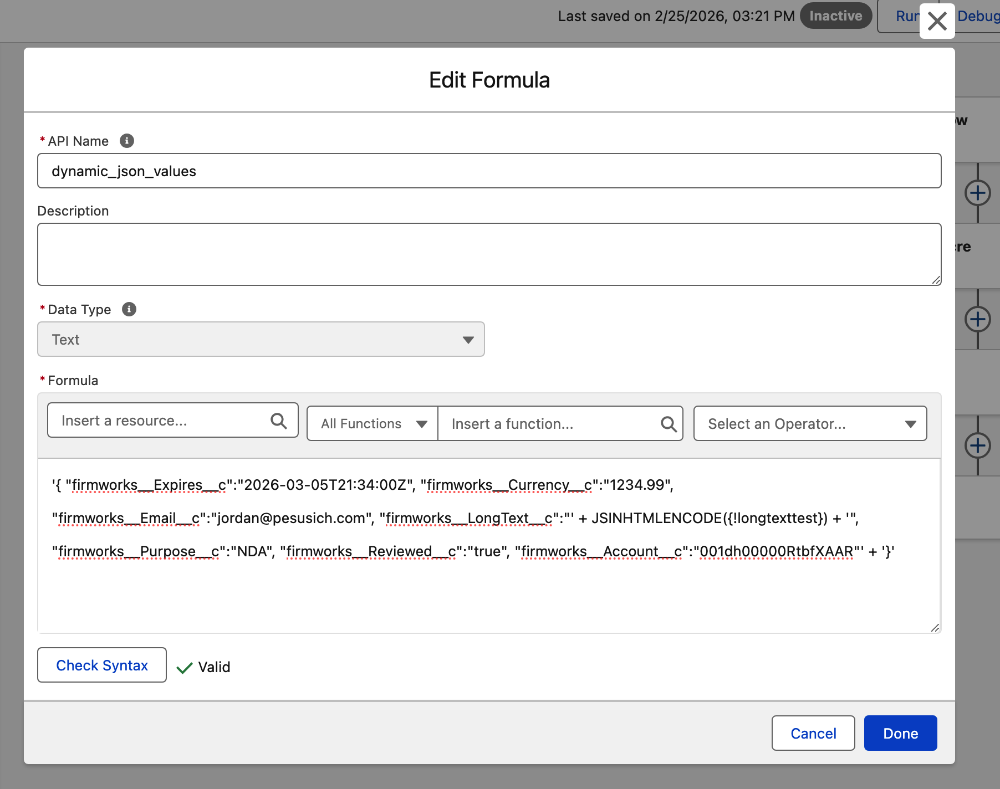
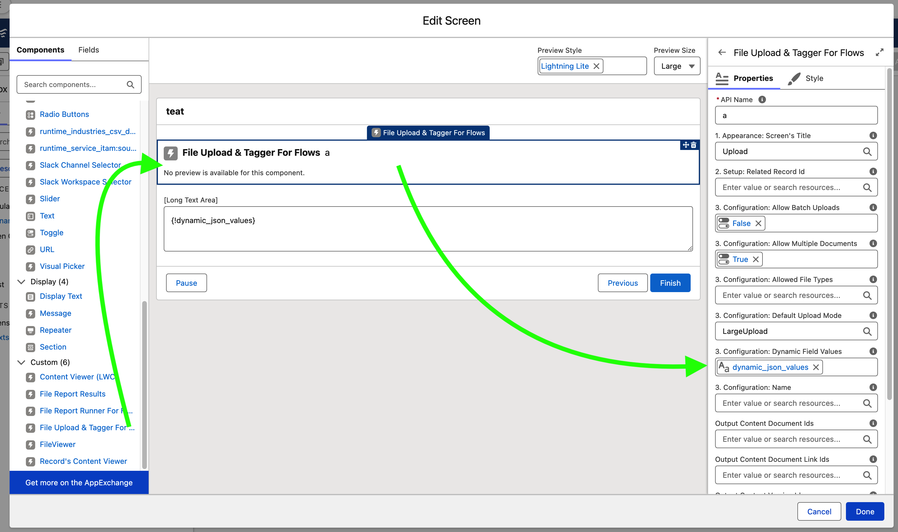
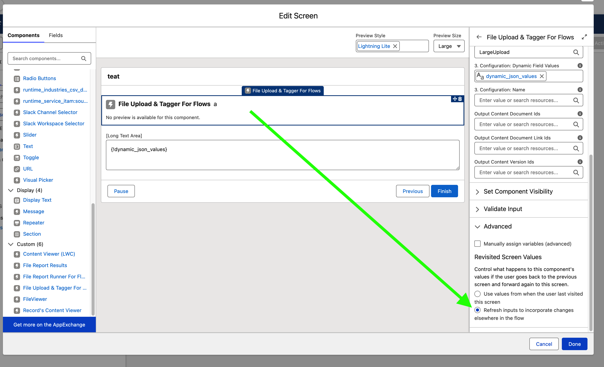

[Back To Documentation](index.md)

# Passing Values Into the File Tagger component

The **3. Configuration: Dynamic Field Values** setting on File Tagger and File Tagger Button takes a JSON string of Content Version field API names and values, and presets those tags when the screen loads. File Manager's **5. Dynamic Configuration: Dynamic Filter Values** setting accepts the same JSON to preset filter values, with extra forms for numeric and date filters described in [Presetting filters in File Manager](#presetting-filters-in-file-manager). This page explains how to build the JSON in a flow formula.

## Prepare a valid JSON string using a Text formula

In this step we are going to create a valid JSON (JavaScript Object Notation) string.

First - retrieve the exact API names of the fields to be set.

Construct the outer wrapper for the JSON object in the formula field like this:
```json
'{' + '' + '}'
```
Fields and their values are constructed using double quotes around the field name, and double quotes around the field value. The field name and the field value are separated by the colon character ":"
If we have a Check box field we want to set to true.

```json
'{' + '"Checkbox_Field__c":"true"' + '}'

becomes

{"Checkbox_Field__c":"true"}
```

Multiple Fields are separated by commas.

Adding a datetime field into the formula.
```json
'{' + '"Checkbox_Field__c":"true", "DateTime_Field__c":"2026-06-01T12:40:00.00Z"' + '}'

becomes

{"Checkbox_Field__c":"true","DateTime_Field__c":"2026-06-01T12:40:00.00Z"}
```



There are limitations of the type of JSON being represented by Salesforce flows using this method - namely it can not represent numbers and booleans as non string values.

|Field Type|Field Values|Note|
|---|---|---|
|Checkbox aka Boolean|"true" or "false"|wrap the true and false values in quotes (not standard json)|
|Lookup|"0010000x0000000000"||
|Currency|"1234.56"|wrap the numerical values in quotes (not standard json)|
|Date|"YYYY-MM-DD" -> "2026-06-20"|[ISO 8601 Formatted Dates](https://www.iso.org/iso-8601-date-and-time-format.html)|
|DateTime|"yyyy-mm-ddThh:mm:ss[.mmm]Z" -> "2025-02-16T10:58:44.965071Z|[ISO 8601 Formatted DateTimes](https://www.iso.org/iso-8601-date-and-time-format.html) Notes Salesforce DateTime components may leave out the "T" in the value.|
|Email|"xxx@xxx.yyy" -> "support@getfirmworks.com" ||
|Number|"####.##" -> "987.65"|wrap the numerical values in quotes (not standard json)|
|Phone|||
|Picklist|"value1"|Use the API value and not the Label|
|Multi-picklist|"value1;value2"|Separate API values are joined with a semi-colon ";"|
|Text|"abc"|*Caution - If allowing user created values, you must escape them with the built in Text formula JSINHTMLENCODE() to ensure they do not corrupt the json|
|Text Area/Long|"abc"|*Caution - If allowing user created values, you must escape them with the built in Text formula JSINHTMLENCODE() to ensure they do not corrupt the json|
|URL|"https://validURL.com"||

## Set the Dynamic Field Value attribute

On the component find "3. Configuration: Dynamic Field Values" from the resource list choose your JSON formatted string resource.



## Presetting filters in File Manager

File Manager's **5. Dynamic Configuration: Dynamic Filter Values** takes the same JSON to select filter values when the component loads. Picklist, checkbox, lookup and text filters take the value forms in the table above. Numeric and date filters also accept an object with an operator:

| Filter | Value forms |
|---|---|
| Number, currency, percent | A number for equals: `{"Amount__c": 100}`. Or an object: `{"Amount__c": {"operator":"between","from":100,"to":500}}` or `{"Amount__c": {"operator":"greater-than-equal","value":100}}`. Operators: `equals`, `not-equal`, `less-than`, `less-than-equal`, `greater-than`, `greater-than-equal`, `between`. |
| Date, date/time | An ISO date for equals: `{"Signed_On__c": "2026-01-15"}`. Or an object with a SOQL date literal: `{"Signed_On__c": {"operator":"greater-than-equal","date_literal":"LAST_N_DAYS:30"}}`, or a range: `{"Signed_On__c": {"operator":"between","from":"2026-01-01","to":"2026-03-31"}}`. |

In a flow formula the same quoting rules apply: wrap the whole object in single quotes and keep the inner double quotes.

## Set the component refresh cycle

**3. Configuration: Dynamic Field Values** and **5. Dynamic Configuration: Dynamic Filter Values** are [reactive settings](fileviewer-and-flow.md#reactive-settings). Bound to a formula or component on the same screen, they update the tag values or the filters as that value changes, with no extra setup.

If the JSON is built on an earlier screen and your flow lets the user go back and change it, the component will not pick up the new value unless it is set to "refresh inputs to incorporate changes elsewhere in the flow" from the Advanced section.



## Troubleshooting

Error in component - Dynamic Field Values: Invalid Fields Detected


A check is performed to ensure that the JSON is properly formatted and that the fields specified exist on the ContentVersion object. Salesforce security guidelines prohibit reflecting user values back as an XSS vulnerability.

The code that is checking is simply the following which can be run from an execute anonymous:

Replace the jsonPayload with the payload you are testing with.

```java
String jsonPayload = '{ "firmworks__Expires__c":"2026-03-05T21:34:00Z", "firmworks__Currency__c":"1234.99", "firmworks__Email__c":"", "firmworks__LongText__c":"hello world", "firmworks__Purpose__c":"NDA", "firmworks__Reviewed__c":"true", "firmworks__Account__c":"001dh00000RtbfXAAR"}';
Map<string,object> jsonMap = (Map<string,object>)JSON.deserializeUntyped(jsonPayload);
Schema.DescribeSObjectResult contentVersion = Schema.getGlobalDescribe().get('ContentVersion').getDescribe();
List<string> invalidFields = new List<string>();
for(string key : jsonMap.keySet()){
    if(!contentVersion.fields.getMap().containsKey(key)){
        invalidFields.add(key); // not going to reflect user data XSS
    }
}
System.debug(String.join(invalidFields,','));
```