[Back To Documentation](index.md)

# The Life of a File

FirmWorks Files provides a myriad of components to assist in working with Salesforce files. The story begins with ingestion of the file via uploading to Salesforce.

### Uploading

#### Upload up to thousands of files at once with Enhanced Upload

Native Salesforce limits users to 10 at a time (Limit can be increased to 25)

Firmworks Files gives users the ability to upload thousands at a time.
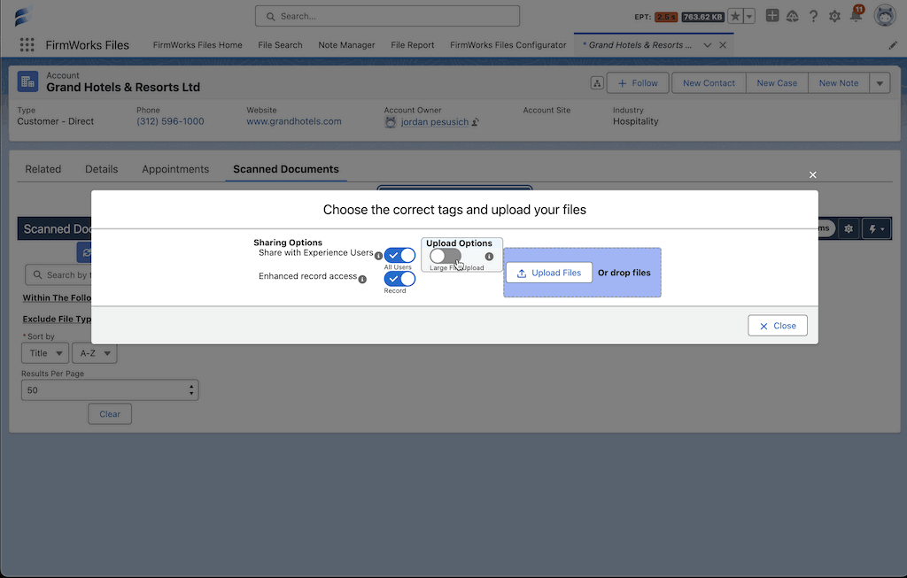

#### Upload new versions and skip duplicates
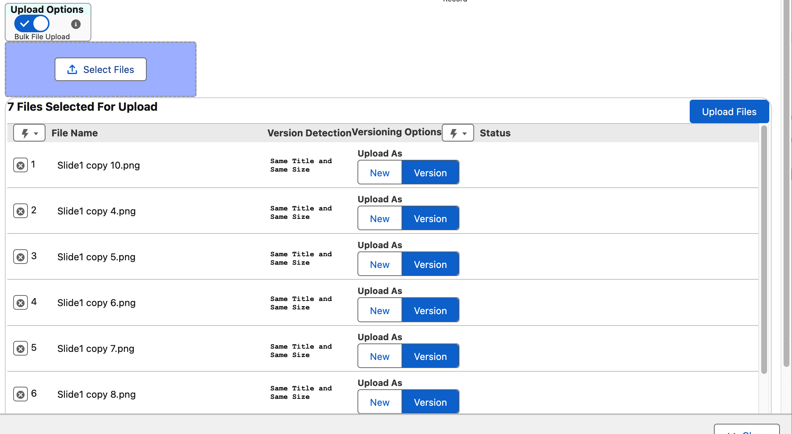

#### Tag files with their correct taxonomies during upload
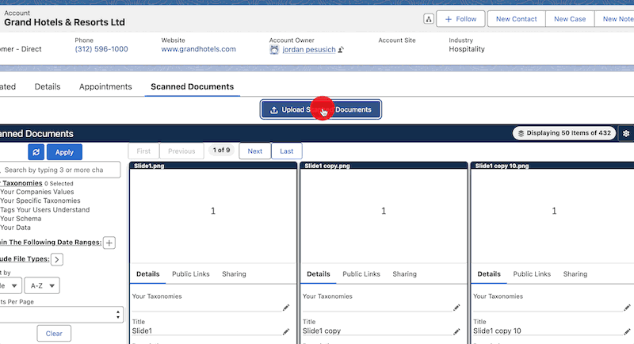

#### Curate experiences to minimize users uploading the wrong documents
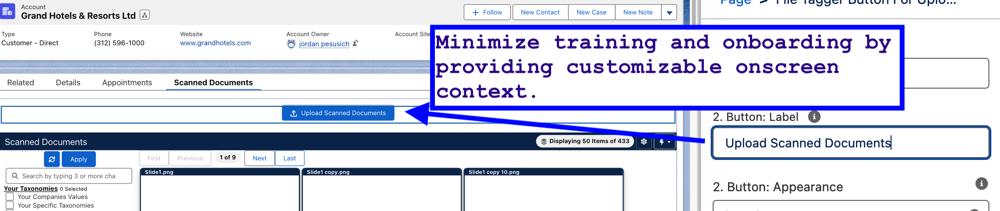

### Tagging

#### Tag files easily and quickly that are already in the system

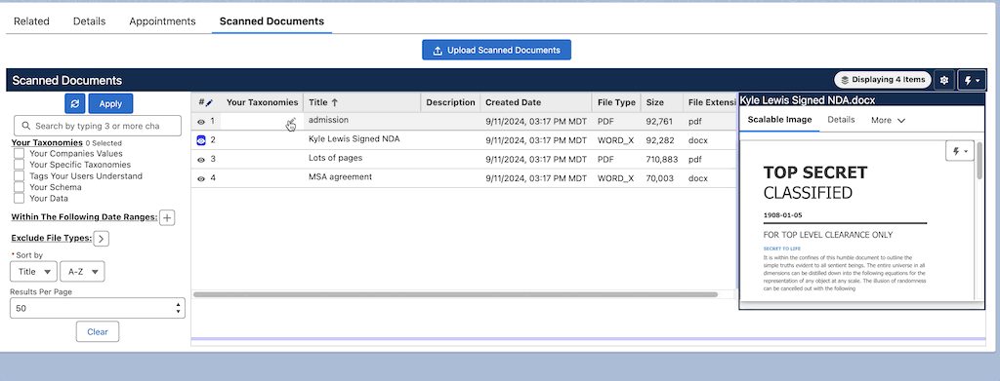

#### Tag, relink or re-own hundreds of files in one step with bulk actions

Select the files from any search and set their tags, find and replace in text fields, link them to records or change their owner together. See [Bulk Actions](bulk-actions.md).

#### Find the files that slipped through untagged

The [Files Dashboard](files-dashboard.md) counts files with no tags and opens them in File Manager, ready for bulk tagging.

#### Create processes and workflows to audit files for accuracy

Support files in flows and automation

### Searching and Filtering

#### Search for files by their content

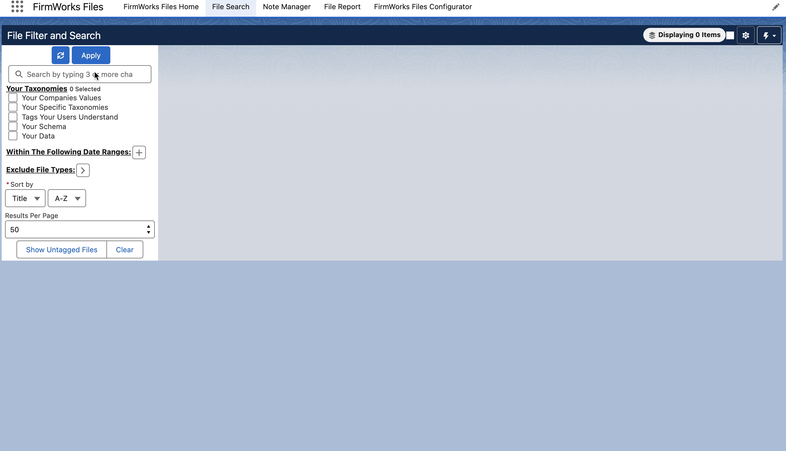

#### Search for files tagged

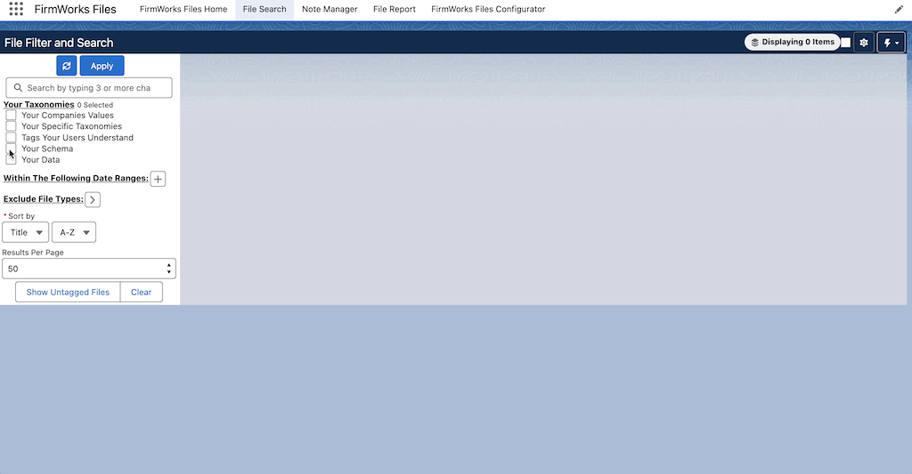

### Viewing

#### View videos, photos, pdfs, word docs, heic files and more

#### Curate tabs on layouts to help your teams instantly find files without opening them all - Carousel and tabbed viewers
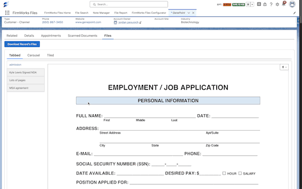

### Sharing

#### Share links to files easily with users outside of Salesforce, complete with expirations and passwords

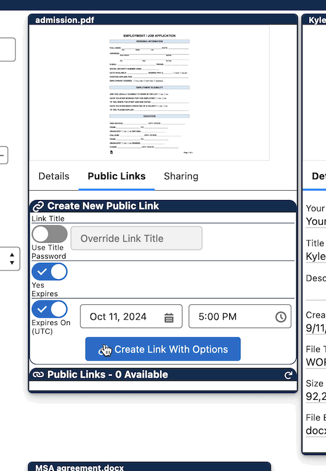

#### 1 click make files viewable to related records

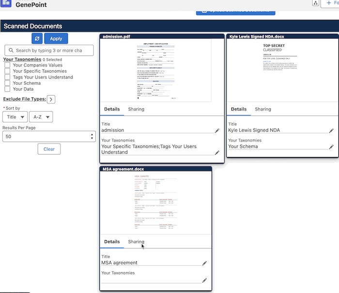

#### Download all of the files in any view in a single zip file

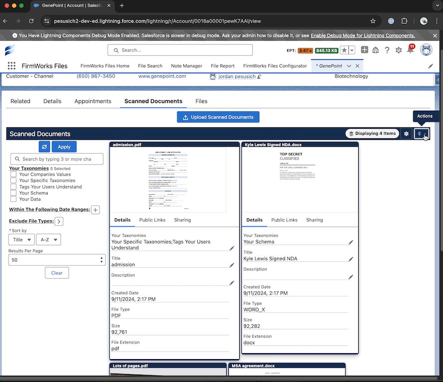

### Maintaining

#### See every version of a file and prune the ones you no longer need

The Versions tab lists each version with who uploaded it, opens older versions in the viewer, and can collapse the history to the latest version to free storage. See [Versions](component-appendix.md#versions).

#### Watch storage, licenses and setup from one page

The [Files Dashboard](files-dashboard.md) shows file storage, license seats, configurations, reports, schedules and automations with links to manage each.

### Automate Auditing & Compliance

#### Discover Salesforce records that don't have a file of a specific taxonomy

#### Complete file profiles where multiple heterogeneous files make up the completeness of a bundle of files

#### Schedule reports that generate platform events to drive business processes and get your users to perform the activities required.

#### Find files to be culled for clean up

#### Automate deleting or migrating files off platform with scheduled reports

